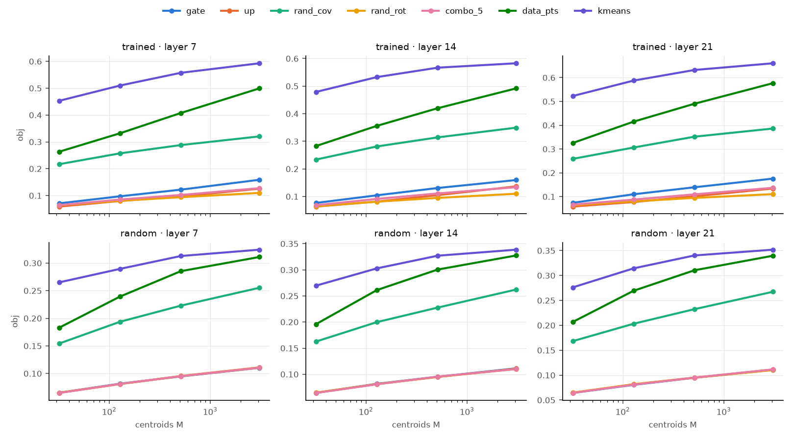
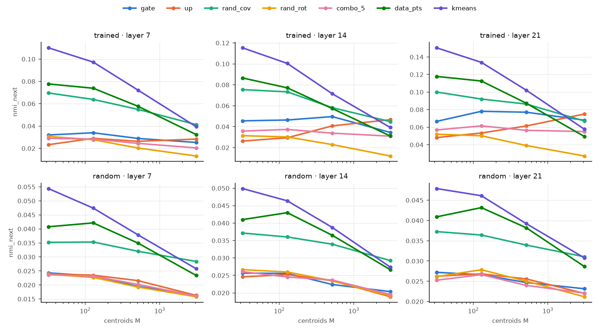

# Experiment A — do neuron weights act as cluster centroids of the MLP input?

*Qwen3-0.6B, layers 7 / 14 / 21, holdout split of `qwen3_0.6b_small_v1`. Run 2026-10-25. Code: `src/combo_interp/geometry.py`,
`src/combo_interp/geometry_report.py`, `scripts/09_centroids.py`; raw outputs in
`/Users/rohanbuluswar/combo_runs/qwen3_0.6b_small_v1/data/results/geometry/`.*

## 1. Why this experiment

Our agent study asks whether single MLP neurons are easier to explain than random linear combinations of neurons
(`ksparse_k`, `dense_*`), with `related_k` as a positive control. If neurons do come out ahead, we want to know *why*.

Abedsoltan, Boix-Adsera, Kalogiannis & Belkin, *Revenge of Monosemanticity* (arXiv 2608.24007), give a candidate
mechanism. They train MLPs on regression data drawn from K clusters, where each cluster has its own predictive
direction. Individual neurons then **specialize**: a neuron's first-layer weight vector mostly points along one cluster's
predictive direction, plus a small "routing" component that puts its firing threshold *inside one cluster*. Each neuron
is therefore a local expert: it is active in one region of input space and linear in a relevant feature there. In
gated MLPs (ReGLU / SwiGLU) the paper credits the gate branch with selecting the cluster and the value branch with
carrying the feature. Their §3.3 shows that the trained first layer encodes the cluster structure: k-means on the
active neurons' representation recovers clusters well enough to fit good local predictors.

Applied to our study, the story would be:

* A neuron fires in **one region** of the MLP input space, so its top activations share one context, and one sentence
  can explain it.
* A random combination of k neurons fires in the **union of k regions**, so it is polysemantic by construction and
  explanations degrade as k grows.
* `related_k` combines neurons that fire together (one region), so it should stay explainable.

That story has two separable ingredients:

* **(A) Mechanical:** combinations are unions of regions. This comes from gating alone and could hold even in an
  untrained network.
* **(B) Learned:** the gate weights are *aligned with real structure in the data*, i.e. they sit on the clusters the
  model's inputs actually form.

**Experiment A tests (B) for the whole set of neurons at once:** used as centroids, do the gate weight vectors
partition the MLP's inputs better than random centroids do? Experiment B (next) tests the per-unit version and links
it to the agents' scores.

## 2. What exactly is measured

### Data

* **Tokens.** The 50,178 tokens of the holdout split's cached uniform sample (`cache/holdout/L*/uniform.npz`; position 0
  is excluded, as everywhere in the study). The 450 holdout documents mix web, edu, code and Wikipedia in 7 languages.
* **The vector per token.** `x` = the MLP input at layer L. That is the tensor fed into `gate_proj` (after RMSNorm,
  including its learned scale), captured with a new hook (`MLPCapture(capture_input=True)`). The choice matters:
  `W_gate[j] · x` is *exactly* neuron j's gate pre-activation, so the gate row is the natural "neuron weight" in the
  paper's sense. It is the counterpart of their first-layer weight `w_j`.
* **Fit / evaluation split by document.** Even `seq_id` documents are the *fit* half (used to build the data-derived
  centroids and the covariance); odd documents are the *evaluation* half that every number below is computed on.
  Splitting by document means no centroid is ever evaluated on its own document.
* **Centering (primary analysis).** Subtract the mean `x` (computed on the fit half) before measuring cosines. Without
  this, the residual stream's large shared mean dominates every cosine (§4.6).

### Centroid sets

Each "centroid set" is M unit vectors in the 1024-dim MLP-input space, with M ∈ {32, 128, 512, 3072}
(3072 = d_ff = all neurons). Random sets are redrawn 10 / 10 / 5 / 3 times for the four values of M.

| set | construction | what it holds fixed / tests |
|---|---|---|
| `gate` | M random rows of `W_gate` | **the test set**: the neurons' own input weights |
| `up` | M rows of `W_up` | the value branch. The paper predicts the gate, not the value, does the routing |
| `rand_iso` | isotropic Gaussian directions | weakest baseline: knows nothing about the data or the weights |
| `rand_rot` | the same gate rows times one random rotation Q | keeps the set's internal geometry (all norms and angles between neurons) but destroys its alignment with the data. **Cleanest null for "aligned with data"** |
| `combo_k` (k = 2, 5, 20) | each centroid a Gaussian-weighted sum of k random unit gate rows | the input-space analogue of our `ksparse_k` units |
| `rand_cov` | Gaussian with the data's covariance, N(0, Σ_x) | random directions that know how stretched the data is in each direction (its anisotropy) |
| `data_pts` | M random tokens' `x` from the fit half | data-aligned random centroids (k-means++-style seeding) |
| `kmeans` | spherical k-means (20 iterations) on the fit half | upper bound: the best M centroids for this objective |

### Assignment and metrics

Each evaluation token is assigned to its most similar centroid, `argmax_j cos(c_j, x)`. That turns every centroid set
into a partition of the tokens, which is then scored:

* **`obj`**: mean over tokens of the maximum cosine. This is the spherical k-means objective: how close the typical
  token is to some centroid.
* **`obj_norm`** = (obj − obj[`rand_cov`]) / (obj[`kmeans`] − obj[`rand_cov`]). It is 0 at the covariance-matched
  random null and 1 at k-means, so negative means worse than random-with-the-data's-covariance.
* **`eff_k`**: effective number of clusters actually used, exp(entropy of cluster sizes). This detects degenerate
  partitions where one centroid absorbs everything.
* **Label purity, `nmi_token` / `nmi_next` / `nmi_doc`**: normalized mutual information between the partition and
  (i) the token at that position, (ii) the next token, (iii) a coarse document label (code / ja / ru / bn / de / fr / es
  / en / other). We report the NMI *minus* the NMI of a random partition with identical cluster sizes. Plain NMI rises
  mechanically with the number and balance of clusters; subtracting this chance level removes most of that bias, so
  the result measures "how much does this partition know about the text".
  The document labels come from a content heuristic (script detection, stopword counts, code-symbol density): the
  corpus does not store each document's source, and the corpus builder's mixing order cannot be replayed (it breaks
  ties by set-iteration order, which depends on Python's per-run hash seed). Label shares (tokens): en 35.2k,
  code 3.2k, es 2.2k, fr 2.0k, other 1.8k, de 1.6k, ja 1.6k, ru 1.6k, bn 1.0k.

### Controls

* **Random-init model.** Same architecture, untrained weights (`AutoModelForCausalLM.from_config`, seed 0), run
  through the whole pipeline. Anything that also appears here comes from architecture or geometry, not learning.
* **Uncentered variant** (`--set geometry.center=false`). Cosines on raw `x`, closer to what the gate computes since
  Qwen has no biases.

### Pre-stated predictions

If neuron weights are learned cluster centroids as in the paper, then:

1. `gate` > `rand_rot`, `rand_iso` (alignment with the data, not just set geometry);
2. `gate` > `combo_2` > `combo_5` > `combo_20` (combining dilutes alignment);
3. `gate` ≥ `rand_cov` and close to `data_pts` (the weights sit on the dominant clusters);
4. `gate` > `up` (the gate routes);
5. none of this in the random-init model.

## 3. Results at a glance

| prediction | outcome |
|---|---|
| 1. gate beats geometry-matched random sets | **Yes.** At every layer and M, and in every repetition |
| 2. dilution with k | **Yes.** Monotone at every layer |
| 3. gate sits on the dominant clusters | **No.** Gate rows are far worse than covariance-matched random directions and than random data points |
| 4. gate > up | **Yes** on the objective (all 12 layer × M cells). **No** on label purity at large M, where `up` ties or wins |
| 5. nothing in the random-init model | **Yes.** All weight-based sets are indistinguishable from random there |

So neuron weights are **learned, data-aligned partitioners, but of low-variance directions, not of the data's main
cluster structure**.

## 4. Results in detail

### 4.1 Gate rows vs geometry-matched nulls (trained model)

`obj` (mean max-cosine on the evaluation half), median over repetitions:

| M | layer | gate | combo_2 | combo_5 | combo_20 | rand_rot | rand_iso | up |
|---|---|---|---|---|---|---|---|---|
| 32 | 7 / 14 / 21 | .071 / .077 / .074 | .066 / .071 / .068 | .065 / .068 / .067 | .064 / .068 / .064 | .064 / .065 / .064 | .064 / .064 / .064 | .059 / .064 / .059 |
| 128 | 7 / 14 / 21 | .097 / .104 / .110 | .086 / .094 / .093 | .085 / .091 / .088 | .081 / .086 / .083 | .081 / .081 / .080 | .081 / .081 / .081 | .080 / .082 / .077 |
| 512 | 7 / 14 / 21 | .122 / .131 / .139 | .109 / .118 / .115 | .102 / .111 / .110 | .097 / .103 / .099 | .094 / .095 / .095 | .095 / .095 / .095 | .097 / .105 / .102 |
| 3072 | 7 / 14 / 21 | .159 / .160 / .176 | .137 / .143 / .153 | .128 / .134 / .137 | .115 / .122 / .120 | .110 / .110 / .111 | .111 / .111 / .111 | .126 / .137 / .134 |

* `gate` beats `rand_rot` in **all 12 (layer, M) cells, in every repetition**. The rotation keeps every norm and angle
  inside the set, so the difference can only come from where the set points relative to the data.
* The gap is small for few centroids (+10–20 % at M = 32) and grows with M (+45–60 % at M = 3072). Each neuron covers
  only a small part of the inputs, so the benefit appears when many neurons are used together.
* **Dilution is monotone:** gate > combo_2 > combo_5 > combo_20 ≈ rand_rot at every layer and M ≥ 128. A combination
  of 20 neurons has lost essentially all its alignment with the data. This parallels the k-dose-response design of
  the agent study, here measured in the input space instead of by explanation quality.
* The absolute numbers are low (a typical token has cosine ≈ 0.1–0.18 with its best neuron) because the centered
  1024-dim inputs are spread out. Only the comparisons between sets carry meaning.

### 4.2 Random-init control

In the untrained model, `gate`, `up`, `rand_rot`, `rand_iso` and all `combo_k` sets agree to within ±0.001 at every
layer and M (e.g. 0.110–0.111 at M = 3072). They also agree on every purity metric. Random weights are just random
directions, so **everything in 4.1 is learned.** The data-derived sets (`rand_cov`, `data_pts`, `kmeans`) still beat
them, because even an untrained network's inputs are anisotropic and clustered (token embeddings pass through).



*Top row: trained. Bottom row: random init. In the trained model the blue gate line separates from the orange/pink
random-geometry lines. In the random-init model they coincide. In both, the data-derived sets (`rand_cov` green,
`data_pts` dark green, `kmeans` violet) are far above.*

### 4.3 Gate rows vs data-derived centroids: prediction 3 fails

`obj_norm` (0 = `rand_cov`, 1 = `kmeans`), trained model:

| M | gate (L7 / L14 / L21) | rand_rot | data_pts |
|---|---|---|---|
| 32 | −0.62 / −0.64 / −0.70 | −0.65 / −0.69 / −0.74 | +0.20 / +0.20 / +0.25 |
| 3072 | −0.59 / −0.81 / −0.77 | −0.77 / −1.03 / −1.01 | +0.66 / +0.61 / +0.70 |

Gate rows close only a small part of the gap between random rotations and covariance-matched random directions. Even
32 random tokens used as centroids do far better.

**Why:** a diagnostic computed on the trained inputs. For each direction *w*, take the variance of the inputs along
*w*, divided by the average variance per dimension (median over the set):

| layer | gate | up | isotropic | rand_cov | principal components holding 50 % of the variance |
|---|---|---|---|---|---|
| 7 | 0.91 | 0.75 | 0.97 | 11.2 | 102 / 1024 |
| 14 | 0.99 | 0.81 | 0.96 | 13.0 | 61 / 1024 |
| 21 | 0.88 | 0.67 | 0.95 | 17.2 | 39 / 1024 |

The MLP input is strongly anisotropic: a few dozen principal directions hold half the variance. A direction drawn from
the data's covariance points mostly along them, so it is close (in cosine) to many tokens. **Gate rows are no more
aligned with the high-variance directions than a random isotropic direction is** (up rows even less so). The neurons
read directions in which the inputs vary *little*. Their advantage over random (4.1) comes from *which* low-variance
directions they pick, not from tracking the dominant variation.

This is the main way the LM differs from the paper's toy setting. There, the cluster means are the dominant variation
(separation R ≫ within-cluster noise), so a specialized neuron necessarily has a routing component pointing at its
cluster's mean. Here the dominant variation (presumably large-scale directions such as position-like, language-like
and outlier dimensions) is not what individual neurons encode.

Consistent with that, gate neurons are selective but not tiny: the share of tokens with a positive gate pre-activation
(uncentered `x`, i.e. what the network computes) has median 7.8 % at layer 7, 36.8 % at layer 14 and 14.7 % at layer 21.

### 4.4 What the partitions know about the text (label purity)

Chance-corrected NMI, trained model, centered, M = 3072 (L7 / L14 / L21):

| set | `nmi_token` | `nmi_next` | `nmi_doc` |
|---|---|---|---|
| gate | .076 / .074 / **.117** | .025 / .035 / **.068** | .055 / .056 / .118 |
| up | .065 / .084 / .101 | .028 / .047 / .075 | .049 / .053 / .131 |
| rand_rot | .036 / .029 / .048 | .013 / .012 / .027 | .043 / .041 / .074 |
| combo_20 | .045 / .047 / .074 | .016 / .021 / .041 | .043 / .044 / .100 |
| rand_cov | .088 / .082 / .089 | .041 / .045 / .067 | .101 / .090 / .140 |
| data_pts | .103 / .076 / .098 | .032 / .031 / .049 | .084 / .079 / .123 |
| kmeans | .126 / .098 / .115 | .039 / .039 / .058 | .097 / .092 / .136 |

* Against `rand_rot`, gate partitions carry **2–3× more information** about the current and next token, and more
  about the document type. That is real, learned, text-relevant structure.
* **At layer 21 with all 3072 neurons, the gate partition knows as much about the current and next token as k-means
  does** (.117 vs .115; .068 vs .058), and more than `rand_cov` and `data_pts`, even though it scores far worse on the
  geometric objective. Late-layer neurons carve the input along token- and prediction-relevant lines rather than along
  directions of maximal variance. At layers 7 and 14, and for the coarse document label at every layer, the
  data-derived sets still win.
* At small M (32), gate partitions are only slightly better than random on purity (e.g. `nmi_next` at L21: gate .067,
  rand_rot .052, rand_cov .100).



### 4.5 Gate vs up

On the geometric objective, `gate` > `up` in the median of all 12 cells, and in every repetition in 11 of them (the
exception is L7, M = 32), as the paper's
gate-routes / value-carries story predicts. On label purity at M = 3072 the up rows tie or beat the gate rows
(e.g. `nmi_doc` L21: .131 vs .118; `nmi_next` L14: .047 vs .035), so the split of roles is at best partial in a real LM.

### 4.6 Uncentered variant

Without centering, a handful of gate rows that align with the mean input absorb almost every token. The effective
number of clusters used by the gate partition at M = 3072 is 1.2 / 9.7 / 14.0 (L7 / L14 / L21), against 790 / 770 / 495 when
centered and 230–440 for `rand_rot`. The gate set's `obj` still beats `rand_rot` at M ≥ 512, but its purity numbers
are meaningless (near-empty partitions). This variant is reported for completeness only. The centered analysis is the
primary one, and that choice was made before any results were seen.

## 5. Interpretation

**What Experiment A supports.**
* MLP gate weights are not arbitrary directions: training aligns them with the input distribution, and the resulting
  partition is informative about tokens, next tokens and document type. This holds at every layer and set size, in
  every repetition, and is absent at initialization.
* Mixing neurons destroys this alignment gradually: `combo_2` keeps part of it, `combo_20` almost none. That is the
  qualitative pattern the paper's mechanism predicts for our `ksparse_k` dose-response.

**What it does not support.**
* The strong form of the paper's picture, "each neuron's weight vector is the centre of a data cluster", does not hold
  in Qwen3-0.6B. Gate rows are far from the dominant structure of the inputs (they carry no more input variance than a
  random direction), and random tokens make much better cluster centres.
* So if neurons are more explainable than combinations, it is **not** because each neuron owns one of the big,
  obvious clusters of the residual stream. A better reading is that neurons pick out *specific low-variance features*
  that are well aligned with linguistic structure (most clearly at layer 21). This is closer to the paper's "local
  predictive feature" than to its "routing to a cluster".

**What Experiment A cannot say.**
* It evaluates **the set of neurons as a partition**. The agents explain **one unit at a time**, by its top
  activations. A unit can be locally coherent (its top-activating tokens share one context) without the set of all
  neurons forming good global clusters, and vice versa.
* It lives in the **MLP input space** (`x`), while our units are directions in the **MLP hidden space** (`p`). The
  `combo_k` sets here are combinations of *input* weight vectors, which is not the same object as a `ksparse_k` unit
  (a combination of *activations*). The analogy is suggestive, not exact.
* It does not test ingredient (A), the mechanical "union of regions" effect, which could make combinations less
  explainable even without any learned alignment.

**Experiment B** addresses all three. Per unit and per condition, it measures how local the unit's top activations are
in `x` (spread, number of modes), including a random-direction-in-`x` control. It then checks whether that locality
predicts, and statistically mediates, the agent and pilot metrics.

## 6. Caveats

* One small model (0.6B, d_ff 3072), three layers, one holdout sample of ~25k evaluation tokens. Spread is reported only
  as min / max over 3–10 repetitions, with no confidence intervals or multiple-comparison correction. The
  `gate > rand_rot` result is unanimous across repetitions, so it is unlikely to be noise. Smaller differences
  (e.g. gate vs up on purity) should be treated as tentative.
* Cosine-argmax is one of several ways to turn directions into a partition. A gate is really a half-space test
  (`w·x > 0`) and a neuron can be active in many tokens at once, so a winner-take-all assignment understates overlap.
* The document labels come from a heuristic, and English web / edu / Wikipedia are merged.
* The covariance-matched null `rand_cov` is strong by construction on this objective (it is close to the top principal
  components). That is precisely why the comparison with it is informative, but it means "gate < rand_cov" is partly a
  statement about what the cosine objective rewards.

## 7. Reproduce

```bash
cd combo_interp
python scripts/09_centroids.py --config configs/local_small_study.yaml --init trained     # capture + evaluate (~10 min CPU)
python scripts/09_centroids.py --config configs/local_small_study.yaml --init random
python scripts/09_centroids.py --config configs/local_small_study.yaml --init trained --set geometry.center=false
python scripts/09_centroids.py --config configs/local_small_study.yaml --report
```

Settings live in the `geometry:` block of `configs/default.yaml`. Tests: `tests/test_geometry.py` (planted Gaussian
mixture, where the true means must beat every null; captured inputs must reproduce `gate_proj` outputs).
