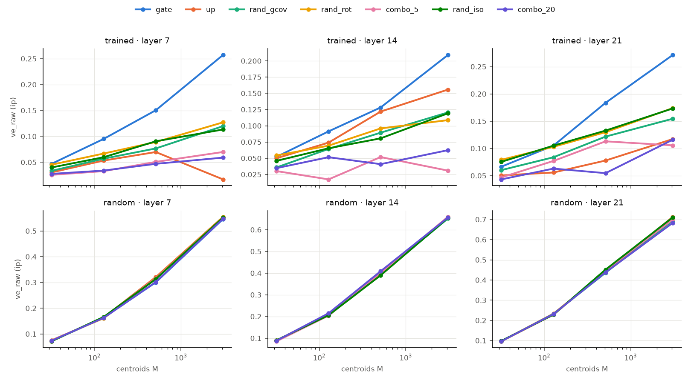
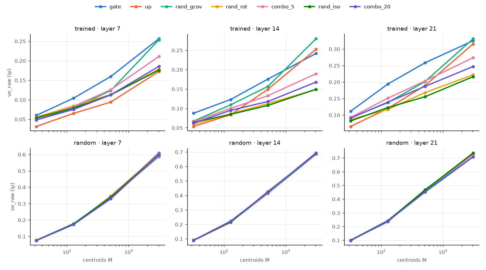

# Experiment A, max-inner-product assignment — does each token's most strongly driven neuron reveal structure?

*Qwen3-0.6B, layers 7 / 14 / 21, holdout split of `qwen3_0.6b_small_v1`. Run 2026-10-26. Companion to
`centroid_experiment_A.md` (same data, sets and metrics; this note covers only the max-inner-product rule). Code:
`src/combo_interp/geometry.py` (`assign_rules=("ip",)`, set `rand_gcov`), `scripts/09_centroids.py`; raw outputs in
`/Users/rohanbuluswar/combo_runs/qwen3_0.6b_small_v1/data/results/geometry/` (rows with `assign == "ip"` in
`*/centroids_raw.csv` for the primary, uncentered analysis and `*/centroids_centered.csv` for the centered one).*

## Summary

Each token is assigned to the neuron whose gate pre-activation `W_gate[j]·x` is largest. The rows keep their native
norms and x is left uncentered. Qwen's MLP has no biases, so this is exactly the number the network computes, with no
normalization or centering choices.

**Primary analysis (uncentered).** With all 3072 neurons, the gate partition explains 1.3–2.0× the input variance
of the best random null. It is clearly ahead of every null at M ≥ 512: by 3–13 points over the same rows randomly
rotated (`rand_rot`), and by 4–14 points over random directions with **the gate rows' mean and covariance**
(`rand_gcov`). By median it beats `rand_gcov`, `up` and all combinations of gate rows in all 12 (layer, M) cells,
and `rand_rot` in 10. The exceptions are M = 32 at layers 14 and 21, where no partition explains more than 8 %.
The random sets mostly collapse onto the few rows with the largest offsets `c_j·mean(x)`; the gate partition does
not, even though the gate rows' offsets vary at least as much. The gate partition also carries more next-token
information than the random sets in 11–12 of 12 cells. None of this appears in an untrained model.

**Secondary analysis (centered x: which neuron responds most to what is specific to this token).** The gate rows
again beat the rotated rows in every cell. The margin at M = 3072 is 1.5–2.3× its size under cosine assignment, and
mixing neurons erodes it in order (k = 2 > 5 > 20, 11 / 12 cells). Here `rand_gcov` catches up on variance explained
with all 3072 centroids, but only through more balanced partitions. It carries a quarter to two-fifths of the gate
partition's next-token information.

## 1. Setup

* **Tokens and inputs.** As in the main document: the 50,178 tokens of the holdout uniform sample. `x` is the MLP input
  (post-RMSNorm, what `gate_proj` reads). Even documents form the fit half (used for the centering mean and the
  covariance), odd documents the evaluation half on which everything is scored.
* **Assignment rule `ip`.** Token → `argmax_j <c_j, x>`, centroids **not** normalized. For gate rows this is "the
  neuron with the largest gate pre-activation".
* **Two input variants**, which answer different questions:
  * *Uncentered* (**primary**): raw x. The score is the network's own pre-activation `W_gate[j]·x`, and neuron j's
    gate switches at `W_gate[j]·x = 0`. Question: *which neuron does this token drive hardest?*
  * *Centered* (secondary): x − mean(x). The score becomes `W_gate[j]·x − W_gate[j]·mean(x)`, i.e. each neuron's
    constant offset (its response to the average token) is removed. Question: *which neuron responds most to what is
    specific to this token?* This is not what the network computes.

  The main document uses centered x as its primary variant because *cosine* assignment collapses without it (one
  gate row wins almost every token at L7). That reason is specific to cosine. For max inner product the uncentered
  version is the faithful one, and it does not collapse (§2.2).
* **Only the assignment differs between the variants.** All metrics below are unchanged by shifting the data (they
  use spreads around cluster means, cluster sizes and labels), so centered and uncentered results differ only in
  which tokens are grouped together.
* **Centroid sets.** M ∈ {32, 128, 512, 3072} rows, redrawn 10 / 10 / 5 / 3 times (the full gate and up sets at
  M = 3072 are drawn once). Under `ip` a row's norm changes the partition, so every set needs a norm convention:

| set | construction | norms |
|---|---|---|
| `gate` | M random rows of `W_gate` | native |
| `up` | M random rows of `W_up` | native (their own, about 14–15 % relative spread vs 22–28 % for gate) |
| `rand_rot` | the same gate rows × one random rotation | native gate norms; keeps all norms and angles, removes alignment with x. **Cleanest null** |
| `rand_gcov` | N(mean of gate rows, covariance of gate rows) | as drawn: mean norm matches the gate rows, but only ~3 % relative spread |
| `rand_iso` | isotropic Gaussian directions | given the norms of randomly drawn gate rows |
| `combo_k` (k = 2, 5, 20) | Gaussian-weighted sum of k random unit gate rows | given the norms of randomly drawn gate rows |

  The data-derived sets of the main document (`rand_cov`, `data_pts`, `kmeans`) are points in x-space, not linear
  functionals, so they have no natural place in this rule and are not included.
* **Metrics** (evaluation half, median over repetitions):
  * `ve_raw` (primary): share of the variance of x explained by the partition, 1 − within-cluster SS / total SS,
    with each cluster's spread measured around the mean of its own tokens. `ve` is the same on unit-normalized x; it is
    within 1 point of `ve_raw` everywhere and is not reported separately.
  * `eff_k`: effective number of clusters, exp(entropy of the cluster sizes).
  * `nmi_token`, `nmi_next`, `nmi_doc`: NMI of the partition with the current token, the next token and a coarse
    document label, minus the NMI of a random partition with the same cluster sizes.

## 2. Primary results: uncentered inputs (the network's own pre-activations)

### 2.1 Variance explained

`ve_raw` (%), trained model, L7 / L14 / L21:

| M | gate | up | rand_gcov | rand_rot | rand_iso | combo_2 | combo_5 | combo_20 |
|---|---|---|---|---|---|---|---|---|
| 32 | 4.7 / 5.2 / 6.6 | 3.0 / 5.0 / 5.0 | 3.3 / 3.6 / 6.0 | 4.5 / **5.4 / 7.9** | 4.0 / 4.6 / 7.5 | 2.4 / 4.1 / 5.3 | 2.6 / 3.0 / 4.7 | 2.8 / 3.5 / 4.3 |
| 128 | **9.5 / 9.1 / 10.5** | 5.3 / 7.4 / 5.6 | 5.7 / 6.4 / 8.4 | 6.7 / 6.9 / 10.3 | 6.0 / 6.5 / 10.5 | 3.6 / 3.3 / 5.1 | 3.3 / 1.7 / 7.7 | 3.4 / 5.2 / 6.3 |
| 512 | **15.0 / 12.8 / 18.4** | 7.0 / 12.2 / 7.8 | 7.7 / 8.9 / 12.2 | 8.9 / 9.6 / 13.0 | 9.0 / 8.1 / 13.3 | 3.7 / 1.9 / 4.9 | 5.1 / 5.2 / 11.3 | 4.7 / 4.1 / 5.5 |
| 3072 | **25.7 / 20.9 / 27.1** | 1.7 / 15.6 / 11.7 | 12.0 / 12.1 / 15.4 | 12.7 / 10.9 / 17.4 | 11.3 / 11.9 / 17.3 | 3.1 / 2.6 / 6.5 | 7.0 / 3.1 / 10.6 | 5.9 / 6.2 / 11.6 |

Gate vs each null, out of 12 cells. "Median" = the gate median is higher. "Every rep" = every gate repetition beats
every repetition of the null.

| null | median | every rep |
|---|---|---|
| `rand_rot` | 10 (loses at M = 32, L14 −0.2 and L21 −1.3) | 5 (M = 512 at L7 and L21; M = 3072 at every layer) |
| `rand_iso` | 11 | 5 |
| `rand_gcov` | **12** (by 0.6–13.7 points) | 6 |
| `up` | 12 | — |
| `combo_2` / `combo_5` / `combo_20` | 12 / 12 / 12 | 7 / 7 / 9 |

Gate − `rand_rot`, points of `ve_raw`:

| M | L7 | L14 | L21 |
|---|---|---|---|
| 32 | +0.2 | −0.2 | −1.3 |
| 128 | +2.8 | +2.2 | +0.2 |
| 512 | +6.1 | +3.2 | +5.4 |
| 3072 | **+13.0** | **+10.0** | **+9.7** |

* **With all neurons, the gate partition is clearly the best,** explaining 2.0 / 1.3 / 1.6× the variance of the best
  null at M = 3072 (`rand_rot` at L7 and L21, `up` at L14).
* **The advantage is a property of many neurons together.** It is absent at M = 32, where all partitions are within
  the repetition spread. It grows steadily with M and is unanimous across repetitions only at M ≥ 512.



*Top: trained. Bottom: random init. In the trained model the gate line (blue) separates from all nulls as M grows.
In the random-init model all sets coincide.*

### 2.2 The random sets collapse, the gate rows do not

Without centering, each row's score includes a constant offset `c_j·mean(x)`, the same for every token. The mean
input is large (its norm is 0.50–0.59 of the typical ‖x‖), so these offsets are large.

Effective number of clusters at M = 3072, L7 / L14 / L21:

| gate | up | rand_gcov | rand_rot | rand_iso | combo_2 | combo_5 | combo_20 |
|---|---|---|---|---|---|---|---|
| **339 / 151 / 98** | 2.4 / 44 / 21 | 142 / 58 / 58 | 137 / 79 / 125 | 88 / 91 / 127 | 4.4 / 3.5 / 8.4 | 18 / 4.0 / 16 | 25 / 8.5 / 31 |

* **For random rows, the offsets decide the partition.** With the rotated rows (`rand_rot`, M = 3072), the 30 rows
  with the largest offsets take 30 % / 66 % / 42 % of all tokens (L7 / L14 / L21). This diagnostic uses one random
  rotation and all 50k tokens, separately from the main runs.
* **For the gate rows they do not.** The 30 gate rows with the largest offsets take only 2 % / 21 % / 19 % of tokens.
  Yet the gate rows' offsets vary *more* than the rotated rows' (standard deviation over rows 0.76 / 0.86 / 1.60 vs
  0.63 / 0.50 / 0.87), and about as much as the token-specific part of the score. Training has arranged the rows so
  that the largest pre-activation still depends on the token, not on a few always-dominant neurons.
* **Comparison with cosine.** Under cosine assignment on the same uncentered x (main document, §4.6) the gate
  partition collapsed to 1 / 10 / 14 effective clusters. Keeping the native norms is what avoids the collapse.
* The up rows collapse at L7 (2.4 effective clusters, 1.7 % variance). The combinations collapse at every layer and
  fall below even `rand_iso` in all 12 cells. Their ordering in k is therefore noise here (gate > combo_2 > combo_5 >
  combo_20 in only 1 / 12 cells), and the dose-response is better read from the centered analysis (§3.1).

### 2.3 What the partitions know about the text

Chance-corrected NMI, trained, M = 3072, L7 / L14 / L21:

| set | `nmi_token` | `nmi_next` | `nmi_doc` |
|---|---|---|---|
| gate | **.083** / .076 / **.121** | **.032** / .042 / **.083** | **.058 / .054 / .151** |
| up | .033 / **.098** / .103 | .002 / **.053** / .059 | .019 / .050 / .099 |
| rand_gcov | .059 / .053 / .080 | .021 / .023 / .045 | .043 / .037 / .093 |
| rand_rot | .066 / .045 / .071 | .028 / .027 / .051 | .054 / .051 / .087 |
| rand_iso | .062 / .047 / .067 | .026 / .027 / .046 | .055 / .049 / .086 |
| combo_2 | .018 / .012 / .046 | .009 / .017 / .033 | .019 / .013 / .064 |
| combo_5 | .062 / .022 / .060 | .019 / .016 / .047 | .036 / .017 / .079 |
| combo_20 | .052 / .039 / .073 | .022 / .022 / .053 | .047 / .027 / .088 |

* Across all 12 cells, the gate median on `nmi_next` beats `rand_gcov` and every combination in 12, `rand_rot` and
  `rand_iso` in 11, and `up` in 10.
* At M = 3072 the gate partition carries 1.1 / 1.6 / 1.6× the next-token information of the rotated rows, and the
  most document information of any set at every layer (.151 at L21).
* At L14 the up rows carry more current- and next-token information than the gate rows (.098 vs .076, .053 vs .042),
  although they explain less variance. That fits the main document's finding that `up` rows rival `gate` rows on
  label purity at large M.

## 3. Secondary results: centered inputs (token-specific drive)

Here each neuron's response to the average token is subtracted before taking the argmax.

### 3.1 Variance explained

`ve_raw` (%), trained model, L7 / L14 / L21:

| M | gate | up | rand_gcov | rand_rot | rand_iso | combo_2 | combo_5 | combo_20 |
|---|---|---|---|---|---|---|---|---|
| 32 | **6.0 / 8.8 / 11.2** | 3.2 / 5.4 / 6.6 | 4.9 / 6.8 / 9.2 | 5.5 / 5.9 / 8.7 | 5.4 / 6.5 / 8.2 | 5.3 / 7.1 / 10.4 | 5.0 / 6.6 / 9.3 | 4.9 / 6.3 / 9.1 |
| 128 | **10.4 / 12.3 / 19.4** | 6.5 / 8.4 / 12.0 | 7.9 / 11.0 / 13.8 | 8.5 / 8.6 / 11.7 | 7.9 / 8.5 / 12.3 | 8.6 / 10.3 / 16.0 | 8.3 / 10.0 / 15.1 | 7.5 / 9.5 / 13.9 |
| 512 | **16.0 / 17.6 / 25.9** | 9.4 / 15.0 / 19.0 | 12.4 / 15.7 / 20.2 | 11.3 / 11.3 / 16.8 | 11.3 / 10.8 / 15.6 | 13.8 / 14.0 / 21.3 | 12.6 / 13.3 / 20.3 | 11.3 / 11.8 / 18.7 |
| 3072 | 25.7 / 24.2 / 32.5 | 17.3 / 25.3 / 31.6 | 25.4 / **28.0 / 33.1** | 17.8 / 14.9 / 22.2 | 17.6 / 15.0 / 21.6 | 22.5 / 18.7 / 30.0 | 21.1 / 19.0 / 27.4 | 18.6 / 16.8 / 24.7 |

| null | median (of 12) | every rep (of 12) |
|---|---|---|
| `rand_rot` | **12** (by 0.5–10.3 points) | 9 (not M = 32 at L7 and L21; M = 128 at L14) |
| `rand_iso` | 12 | 10 |
| `rand_gcov` | 10 (loses at M = 3072, L14 −3.8 and L21 −0.6; ties at L7 +0.3) | 6 |
| `up` | 11 (loses at M = 3072, L14) | — |
| `combo_2` / `combo_5` / `combo_20` | 12 / 12 / 12 | 7 / 7 / 8 |

* **Gate rows beat the rotated rows in every cell,** from +0.5 / +2.9 / +2.5 points at M = 32 to
  +7.9 / +9.3 / +10.3 at M = 3072. Under cosine assignment the same comparison gave +5.3 / +4.5 / +4.5 at M = 3072
  (main document, §4.7). Keeping the native norms makes the gate's advantage 1.5–2.3× larger.
* **Dilution is orderly:** gate > combo_2 > combo_5 > combo_20 in 11 / 12 cells (at M = 3072, L14, combo_5 is 0.3
  points above combo_2), cleaner than under cosine assignment (8 / 12). Unlike the uncentered case, the combinations
  do not collapse here, so this is where the dose-response can be read.
* **Partitions are coarser than under cosine:** 311 / 200 / 328 effective clusters for gate at M = 3072, against
  791 / 769 / 494. Larger-norm rows win more tokens.



### 3.2 The gate-covariance null catches up, through balance

`rand_gcov` keeps everything about the gate rows that a Gaussian can: their mean and their full 1024 × 1024
covariance (participation ratio 528–618 of 1024 dimensions, so far from isotropic). It loses everything beyond
second order, and the identity of individual rows. Up to M = 512 the gate rows beat it in every cell (by 1.1–5.7
points). At M = 3072 it ties at L7 and wins at L14 and L21. Two observations say this is not because it captures
the data's structure better:

* **It partitions much more evenly.** At M = 3072 its effective cluster count is 1954 / 1546 / 1374, against
  311 / 200 / 328 for gate. A Gaussian draw in 1024 dimensions has nearly constant norm (~3 % relative spread vs
  22–28 % for gate rows), so under `ip` it behaves almost like cosine assignment and spreads tokens over many cells.
  Finer, more even partitions explain more variance almost automatically.
* **It knows little about the text.** At M = 3072 its partition carries .012 / .015 / .028 next-token information,
  against .033 / .055 / .069 for gate, less than every other set.

In the uncentered analysis, where the offsets stay in, `rand_gcov` loses to the gate rows in every cell (§2.1).

### 3.3 What the partitions know about the text

Chance-corrected NMI, trained, M = 3072, L7 / L14 / L21:

| set | `nmi_token` | `nmi_next` | `nmi_doc` |
|---|---|---|---|
| gate | **.081 / .129 / .135** | **.033 / .055** / .069 | **.069 / .077** / .132 |
| up | .051 / .069 / .102 | .022 / .040 / .063 | .032 / .046 / .109 |
| rand_gcov | .031 / .032 / .052 | .012 / .015 / .028 | .037 / .036 / .079 |
| rand_rot | .050 / .044 / .063 | .019 / .024 / .039 | .051 / .051 / .081 |
| rand_iso | .050 / .046 / .063 | .018 / .022 / .042 | .049 / .047 / .084 |
| combo_2 | .074 / .076 / .103 | .027 / .048 / **.070** | .058 / .052 / .127 |
| combo_5 | .064 / .061 / .088 | .024 / .034 / .060 | .052 / .055 / **.132** |
| combo_20 | .047 / .056 / .075 | .020 / .032 / .049 | .047 / .049 / .097 |

* Across all 12 cells, the gate median on `nmi_next` beats `rand_iso`, `rand_gcov`, `up`, `combo_5` and `combo_20`
  in 12, and `rand_rot` and `combo_2` in 11.
* At L14 the gate partition carries 2.3–2.9× the next-token and token information of the rotated rows. With the
  offsets removed, the gate partitions are more informative about the current token than in the uncentered
  analysis (.129 vs .076 at L14).


## 4. Random-init control

Same architecture, untrained weights, run through the same pipeline. No set stands out. Uncentered, gate −
`rand_rot` ranges from −1.5 to +0.3 points of `ve_raw`, and all eight sets agree to within 3.0 points in every cell.
Centered: −0.8 to +1.3, within 2.9. Effective cluster counts and all three NMIs are the same across sets. Gate beats
`rand_rot` in every repetition in 0 (uncentered) and 1 (centered) of 12 cells. Everything in §2–3 is learned.

## 5. Interpretation

* **In the network's own terms, each token's most strongly driven neuron reveals learned structure.** With the
  uncentered pre-activations, the trained gate rows partition the inputs into groups that are more compact and more
  informative about the text than any random set: the same rows rotated, random directions with their mean and
  covariance, or mixtures of them. This only shows when many neurons are used together.
* **The offsets matter, and training has handled them.** Random rows with large offsets `c·mean(x)` absorb most
  tokens. Gate rows have offsets that are at least as large, yet the winning neuron still depends on the token. One
  reading: neurons are organized so that their constant responses to the average token do not drown out their
  token-specific responses. This is also why the network-faithful partition does not collapse even though the
  centered cosine analysis needed centering to avoid collapse.
* **Second-order statistics of the gate rows are not enough.** Random directions with the gate rows' mean and
  covariance lose to them in every uncentered cell. In the centered analysis they match on variance explained only
  through more balanced partitions, carrying a quarter to two-fifths of the gate's next-token information.
* **Combining neurons dilutes the structure.** In the centered analysis, where the mixtures do not collapse, this is
  monotone in k (11 / 12 cells): the input-space counterpart of the `ksparse_k` dose-response in the agent study.
  Uncentered, mixtures of gate rows are worse than isotropic random directions.
* **Remaining limit.** This is a winner-take-all view: one neuron per token. The paper's claim is per neuron (each
  neuron fires within one cluster), and many neurons fire per token. A cluster served by many neurons appears here
  as a fine refinement, which the symmetric NMI penalizes.

## 6. Caveats

* **`rand_gcov` is not norm-matched.** Its norms hardly vary (~3 % relative spread vs 22–28 % for gate rows), which
  makes its partitions more balanced than the gate's. That drives its strong centered `ve_raw` at M = 3072. A
  version with the gate rows' norms (shuffled) would isolate the covariance itself. `rand_iso` and `combo_k` do get
  gate-row norms.
* `up` keeps its own native norms, which differ from the gate's, so gate vs up mixes direction and norm.
* **Small sets are noisy in the primary analysis.** Uncentered, the gate rows beat `rand_rot` in every repetition
  only at M ≥ 512 (5 of 12 cells). At M = 32 the two are indistinguishable.
* The data-derived references of the main document (`rand_cov`, `data_pts`, `kmeans`) do not apply to this rule, so
  there is no upper bound here. Variance explained is also not comparable across rules in absolute terms, because it
  rises with how evenly a partition uses its cells.
* NMI is symmetric (it is the V-measure) and so penalizes refinements of a clustering. Homogeneity, "each cell lies
  in one cluster", would be the cleaner purity measure.
* One model, three layers, ~25k evaluation tokens, 3–10 repetitions, no confidence intervals.

## 7. Reproduce

```bash
cd combo_interp
python scripts/09_centroids.py --config configs/local_small_study.yaml --init trained --set geometry.center=false   # primary (~8 min on an M1 Pro)
python scripts/09_centroids.py --config configs/local_small_study.yaml --init random --set geometry.center=false
python scripts/09_centroids.py --config configs/local_small_study.yaml --init trained     # centered, secondary
python scripts/09_centroids.py --config configs/local_small_study.yaml --init random
```

Each run evaluates every rule in `geometry.assign` (`configs/default.yaml`), including `ip`. Tables of every metric
are in `summary_raw.md` / `summary_centered.md` next to the raw outputs.
