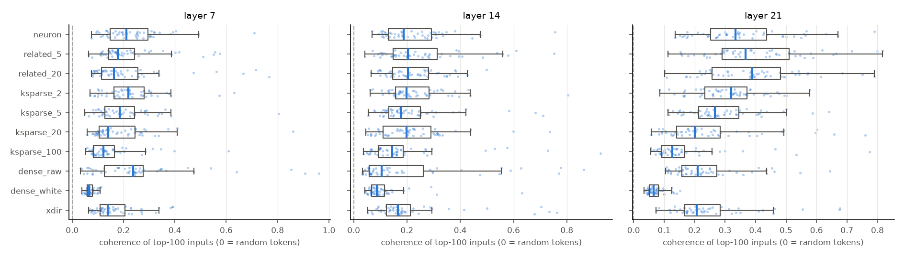

# Experiment B — are a unit's strongest firings local in input space, and does that explain the agents' scores?

*Qwen3-0.6B, layers 7 / 14 / 21, train split of `qwen3_0.6b_small_v1` (the data the agents saw). Run 2026-10-26.
Code: `src/combo_interp/locality.py`, `scripts/10_locality.py`; outputs in
`/Users/rohanbuluswar/combo_runs/qwen3_0.6b_small_v1/data/results/locality/`. Companion to `centroid_experiment_A.md`.*

## 1. Question

Experiment A asked whether the *whole set* of neuron weights partitions the MLP input like cluster centroids. The
answer was: only weakly, and not along the input's dominant structure. That left three gaps:

* agents explain **one unit at a time**;
* our units live in the MLP **hidden** space, while A worked in the **input** space;
* A did not test the mechanical "union of regions" effect.

Experiment B works per unit and per condition, on the same units the study uses (50 per condition × layer, of which
8 per condition × layer were explained by agents), and asks three questions:

1. **Locality.** Are the inputs at a unit's strongest firings close together in the MLP input space? Under the paper's
   picture a neuron fires in one region. A random combination fires in a union of regions, so it should be less local,
   increasingly so with k.
2. **Mechanism.** For sparse combinations, how many of the constituent neurons actually drive the top firings? For
   neurons, is the gate weight the centre of the neuron's own firing set?
3. **Mediation.** Does locality predict the agents' metrics, and does controlling for it shrink the neuron-vs-combination
   gap?

What is being explained: in v1 the only consistent neuron advantage is in **`sim_spearman`**. That is the simulator's
rank correlation with true activations on held-out text, given only the explanation. Combinations score 0.07–0.34
lower (from `results/random_q0.95/equivalence.csv`). On `margin` the combinations actually score *higher*, and
`rate_pred` and `blind_max` are close to equal. So `sim_spearman` was fixed as the primary outcome before the analysis.

## 2. Method

### Top firings per unit

* **Which firings.** For each unit, take the primary pole, chosen by the same rule as `pilot.py` and the agent export.
  From the cached top-1024 firings in the train split, keep the **top 100 with at most one per document** (the same
  dedupe the agents' "one per document" examples use). One per document matters: tokens from the same document share
  context, so without it any unit would look local.
* **What is captured.** The MLP input `x` at layer L at those tokens: the post-norm input of `gate_proj`, as in A. This
  needs one forward pass over the 3M-token train split (CPU, ~1 h).
* **Centering and baseline.** 20,000 uniformly sampled train tokens are captured as well. Their mean is subtracted from
  every `x` before measuring cosines, and they supply the random-token baseline.

### Control condition `xdir`

50 random Gaussian directions `r` per layer **in the MLP input space**, each used as a linear unit `z = r·x`. Each one
gets the same top-100 (one per document) selection, computed in the same pass: per document, the token with the
largest `r·x`. Any single direction's extreme tail is somewhat local, because those tokens all project far along `r`.
`xdir` measures how local "just a direction" is, so neurons have to beat it before locality can be credited to the
gate nonlinearity or to learning.

### Metrics, on the centered, unit-normalized top-100 inputs

| metric | definition | reads as |
|---|---|---|
| `coh_excess` (primary) | mean pairwise cosine of the 100 inputs, minus the median for random sets of 100 uniform tokens (that median is ≈ 0.000 at every layer) | how tightly the strongest firings sit together. 0 = no more than random text |
| `pr` (secondary) | participation ratio of the 100×100 Gram matrix's eigenvalues | effective dimensionality of the firing set. Random sets: 43 / 39 / 34 |
| `k_star`, `sil` | spherical k-means for k = 2…6, best silhouette; `k_star` = 1 if best silhouette < 0.1 | number of modes (turned out not to be usable, §3.5) |
| `cos_gate` (neurons) | \|cos(gate row, mean top-100 input)\| divided by the median of the same for 200 random gate rows | is the neuron's gate weight the centre of its own firing set? |
| `dom_share`, `dom_eff` (ksparse, related) | recompute each constituent neuron's contribution `a_i · p_i(x)` at each top firing. `dom_share` = share of the 100 firings whose largest contribution comes from the most common constituent; `dom_eff` = effective number of dominating constituents (exp entropy) | is a combination's top really a union of its constituents' regions, or one constituent's? |

### Analysis

* **Within-condition association.** Rank both the locality metric and the outcome *within* each condition, then take
  the Spearman correlation (bootstrap CI). This asks whether units that are more local than others *of the same
  condition* are explained better. It is free of the condition-level confounds.
* **Mediation.** OLS of `y ~ condition + layer` (neuron is the reference), then of `y ~ condition + layer + mediator`.
  The reported quantities are the condition effects before ("total") and after ("direct") adding the mediator, and the
  attenuation 1 − direct/total. Bootstrap CIs are 90 %, 2000 resamples of units stratified by condition. Outcomes are
  the agent metrics (216 explained units) and the agent-free pilot metrics (all 1350 units).
* **Robustness.** The same `sim_spearman` regression with the pilot's token-concentration covariates
  (`top_tok_share`, `tok_entropy`, log kurtosis), with and without `coh_excess` / `pr`. Tokens that repeat in a unit's
  top list have near-identical inputs, so coherence could just be token repetition in disguise.

### Deviations from the plan, stated plainly

1. The planned primary mediator was `log(coh / coh_random)`. After centering, the random-set coherence is ≈ 0
   (−0.0003 to 0.0000), so the ratio is ill-defined (huge, sign-flipping values). I replaced it with `coh_excess`,
   the difference, which is the quantity the ratio was meant to express. The first run's ratio-based mediation output
   was discarded. Its `sim_spearman` attenuations were 0.09–0.36, in the same direction as the reported ones but
   computed on a broken scale.
2. The robustness specification (§2, last bullet) was added *after* seeing the main mediation results. Treat it as
   exploratory.
3. `k_star` failed as a metric (§3.5) and is not interpreted.

## 3. Results

### 3.1 Locality by condition

Median `coh_excess` (mean pairwise cosine of the top-100 inputs; random text = 0):

| condition | L7 | L14 | L21 |
|---|---|---|---|
| neuron | **0.21** | **0.19** | **0.33** |
| related_5 | 0.18 | 0.20 | 0.37 |
| related_20 | 0.16 | 0.20 | 0.39 |
| ksparse_2 | 0.22 | 0.20 | 0.32 |
| ksparse_5 | 0.19 | 0.18 | 0.27 |
| ksparse_20 | 0.14 | 0.20 | 0.20 |
| ksparse_100 | 0.12 | 0.14 | 0.13 |
| dense_raw | 0.24 | 0.11 | 0.21 |
| dense_white | 0.07 | 0.09 | 0.07 |
| xdir (random input direction) | 0.14 | 0.17 | 0.21 |



* **Every condition is far more local than random text.** The top firings of *any* unit share a lot of input
  structure (coherence 0.07–0.39 against ≈ 0 for random tokens).
* **Neurons are more local than a random input direction** (0.21 / 0.19 / 0.33 vs 0.14 / 0.17 / 0.21). So neuron
  locality is more than "the tail of some direction is local". This is consistent with the gate carving out a region.
* **Dose-response with k:** at layers 7 and 21 coherence falls steadily from `ksparse_2` to `ksparse_100`
  (L21: 0.32 → 0.27 → 0.20 → 0.13). At layer 14 it is flat until k = 100. `ksparse_2` is as local as a neuron.
* **`related_k` is as local as or more local than neurons**, most clearly at L21 (0.37 / 0.39 vs 0.33), as the positive
  control should be.
* **`dense_white` is by far the least local** (0.07–0.09; effective dimensionality `pr` 23–34 vs 6–13 for neurons).
  `dense_raw` swings across layers (0.24 at L7, 0.11 at L14): raw random directions are dominated by a few
  high-variance hidden directions, which can be local or not.

### 3.2 Mechanism: is a combination's top a union of regions?

`dom_share` (share of the top-100 firings driven mainly by the single most common constituent) and `dom_eff`
(effective number of driving constituents), medians at L7 / L14 / L21:

| condition | dom_share | dom_eff |
|---|---|---|
| ksparse_2 | 1.00 / 1.00 / 1.00 | 1.00 / 1.00 / 1.00 |
| ksparse_5 | 0.86 / 0.96 / 0.92 | 1.54 / 1.17 / 1.36 |
| ksparse_20 | 0.62 / 0.69 / 0.62 | 2.56 / 2.15 / 2.51 |
| ksparse_100 | 0.38 / 0.54 / 0.42 | 5.31 / 3.90 / 4.77 |
| related_5 | 0.92 / 0.93 / 0.96 | 1.35 / 1.32 / 1.17 |
| related_20 | 0.70 / 0.79 / 0.70 | 2.41 / 2.00 / 2.29 |

This is the clearest result of B. **The extreme firings of a sparse random combination are almost always one
constituent neuron's extreme firings.** Neurons are heavy-tailed, so in a mix of 2 (or 5) the largest neuron
excursion wins at the top. A `ksparse_2` unit's top-100 is *literally* one neuron's top region: 100 % of its top
firings come from the same constituent in every median unit. The union of regions only appears at k ≈ 20
(2–2.5 constituents) and k = 100 (4–5). This explains why `ksparse_2` and `ksparse_5` behave like neurons in both
locality and agent scores. As far as the top of the distribution is concerned, they *are* mostly neurons.

**Per-neuron centroid (`cos_gate`).** A neuron's gate row is aligned with the mean input of its own top-100 firings
**12–15× more than a random gate row** (median 14.6 / 12.4 / 12.6; minimum 5.6 across all 150 neurons). So the
paper's picture holds **per neuron**: the gate weight points at the centre of the neuron's own firing region. Together
with A, the picture is: each neuron's weight is the centroid of *its own* region, but those regions are not the
dominant clusters of the input distribution.

### 3.3 Does locality predict the agents' scores?

Within-condition Spearman (both variables ranked within condition, 90 % CI):

| | coh_excess | pr (dimensionality) |
|---|---|---|
| `sim_spearman` | **+0.53 [0.44, 0.61]** | **−0.45 [−0.54, −0.35]** |
| `n_parts` (explainer's own count of independent triggers) | **−0.44 [−0.53, −0.34]** | **+0.39 [0.30, 0.49]** |
| `margin` | −0.06 [−0.18, 0.05] | +0.08 [−0.03, 0.19] |
| `rate_pred` | +0.05 [−0.07, 0.16] | −0.03 [−0.14, 0.08] |
| `blind_max_logratio` | +0.01 [−0.11, 0.12] | +0.00 [−0.11, 0.11] |

* Within any one condition, units with more local top firings get explanations that **rank held-out activations
  better**, and the explainer itself describes them with **fewer parts**. The effect is large (ρ ≈ 0.5).
* Locality is unrelated to the writer-based metrics (`margin`, `rate_pred`, `blind_max`). Those measure whether the
  explanation lets someone *write* text that fires the unit. A union of regions can still be hit by writing text for
  any one of them, so this fits.

### 3.4 Mediation of the neuron advantage in `sim_spearman`

Condition effects relative to neuron (OLS with layer fixed effects, 90 % bootstrap CI):

| condition | total effect | direct effect (+ coh_excess) | attenuation |
|---|---|---|---|
| related_5 | +0.055 [−0.02, 0.14] | +0.026 [−0.05, 0.10] | — (no gap) |
| related_20 | **−0.155** [−0.27, −0.04] | −0.136 [−0.24, −0.03] | 0.12 |
| ksparse_2 | −0.083 [−0.19, 0.02] | −0.053 [−0.15, 0.03] | 0.36 |
| ksparse_5 | −0.073 [−0.17, 0.03] | −0.031 [−0.12, 0.06] | 0.57 |
| ksparse_20 | **−0.147** [−0.25, −0.05] | −0.059 [−0.16, 0.04] | **0.60** |
| ksparse_100 | **−0.263** [−0.38, −0.15] | −0.159 [−0.26, −0.05] | 0.40 |
| dense_raw | **−0.163** [−0.27, −0.06] | −0.111 [−0.21, −0.01] | 0.32 |
| dense_white | **−0.337** [−0.45, −0.22] | −0.175 [−0.29, −0.06] | 0.48 |

Adding `coh_excess` (slope +0.79 [0.65, 0.96] `sim_spearman` per unit of coherence) removes **about a third to 60 %** of the
neuron advantage for every random-combination condition with a clear gap. For `ksparse_20` the remaining gap is no
longer distinguishable from zero. For `ksparse_100`, `dense_raw` and `dense_white` a significant direct effect remains.
**`related_20` is the exception.** It is more local than neurons, yet still 0.15 worse on `sim_spearman`, so locality
cannot explain that gap (§4).

For `margin`, where combinations do *better*, the mediator barely moves the condition effects (attenuation 0.01–0.37;
every gap that was significant stays roughly as large). Its slope is slightly *negative* (−0.24 [−0.45, −0.03]):
across conditions, more local units get slightly lower margins. That fits the reading that writing near-miss texts
is harder when the unit's region is tight. For the agent-free pilot metrics the neuron-vs-combination differences are small to begin with, so attenuation
ratios there are unstable and not interpreted (see `mediation.csv`).

**Robustness: is coherence just token repetition?** (`sim_spearman ~ condition + layer + covariates`; exploratory, §2)

| term | cond only | + token covariates | + tokens + coh | + coh + pr |
|---|---|---|---|---|
| dense_white | −0.337 [−0.45, −0.22] | −0.153 [−0.30, 0.00] | −0.154 [−0.29, −0.01] | −0.094 [−0.22, 0.03] |
| ksparse_100 | −0.263 [−0.38, −0.16] | −0.161 [−0.28, −0.04] | −0.150 [−0.26, −0.03] | −0.180 [−0.28, −0.07] |
| ksparse_20 | −0.147 [−0.25, −0.04] | −0.089 [−0.20, 0.02] | −0.057 [−0.15, 0.05] | −0.075 [−0.16, 0.02] |
| dense_raw | −0.163 [−0.27, −0.06] | −0.031 [−0.19, 0.12] | −0.091 [−0.23, 0.06] | −0.122 [−0.22, −0.02] |
| related_20 | −0.155 [−0.28, −0.04] | −0.058 [−0.17, 0.05] | −0.109 [−0.22, 0.01] | −0.142 [−0.24, −0.04] |
| coh_excess slope | | | **+0.67 [0.46, 0.93]** | +0.44 [0.23, 0.66] |

* The cheap token-concentration statistics from the pilot (how repetitive the top tokens are) already absorb a
  similar share of the gap as coherence does.
* **But coherence keeps a large, clearly nonzero effect after controlling for them** (+0.67 [0.46, 0.93]), so it
  carries information about explainability beyond token repetition. It is input-space context, not just "same token".
* No combination of these covariates removes the `ksparse_100` gap (−0.15 to −0.19 in every specification).

### 3.5 What did not work

`k_star` (number of modes by silhouette) is not informative. Random token sets already get `k_star` = 2 most of the
time (silhouettes of high-dimensional random data sit just above the 0.1 cutoff), and unit medians are 2–5 with no
pattern by condition. The threshold was chosen before the results and was too low. A gap-statistic or
bootstrap-calibrated version would be needed. `pr` (effective dimensionality) carries the "how many directions" signal
instead, and it behaves sensibly (§3.3).

## 4. Interpretation: how much of the neuron advantage does the paper's mechanism explain?

**What the mechanism explains.**

* **Per-neuron specialization is real in Qwen3-0.6B.** Each neuron's gate weight is the centroid of its own firing
  region (12–15× above chance), and neurons fire more locally than a random input direction.
* **Union of regions is real, but only at larger k.** Because neurons are heavy-tailed, small random combinations
  (k ≤ 5) inherit the top region of their strongest constituent and are as local as neurons. That matches the agent
  study, where `ksparse_2/5` were not clearly worse than neurons. At k ≈ 20 the top splits over 2–3 neurons; at
  k = 100 over 4–5, and dense whitened directions are the least local of all. Explanation quality (`sim_spearman`)
  falls along the same order.
* **Locality matters for explanation.** Within every condition, more local units are explained better
  (ρ ≈ 0.5 with `sim_spearman`) and with fewer parts. Locality accounts for roughly a third to 60 % of the
  neuron-vs-random-combination gap in `sim_spearman`, beyond token repetition.

**What it does not explain.**

* **The residual gaps** for `ksparse_100`, `dense_raw` and `dense_white`, roughly half the original size. Something
  besides input-space locality makes these hard to simulate. One candidate: `sim_spearman` also requires ranking
  *intensity* among strong firings (half the items are top firings). A sum of many weak contributions may have an
  intensity order that no single concept tracks, even when its top firings are moderately local.
* **`related_20`:** the most local condition at L21, yet as hard to simulate as `dense_raw`. Grouping 20 correlated
  neurons keeps the *where* coherent but evidently not the *how strongly*. This also points to intensity ranking, not
  locality, as the missing piece.
* **The writer-based metrics** (`margin`, `rate_pred`, `blind_max`) show no neuron advantage in v1, and locality does
  not predict them.

**Answer to the original question.** The paper's mechanism (neurons as local, region-specific units; combinations as
unions of regions) explains a substantial part, but not all, of why agents find neurons more explainable than random
combinations. It works through the simulator metric and through the large-k / dense conditions. The small-k results
are explained by a simple extra fact that the paper's toy setting does not have: heavy-tailed neurons make small
combinations behave like single neurons at the top.

## 5. Caveats

* **Small sample.** 24 explained units per condition (8 per layer), one model, one agent run (v1). The CIs are wide,
  and the attenuation ratios inherit the noise of their denominators.
* **Correlational mediation.** OLS mediation with a measured mediator is not causal. Locality could be a marker of
  some third property (e.g. activation sparsity) that drives both. A causal test would edit locality, e.g. by
  intervening on the unit, which `interventions.py` supports but this analysis does not use.
* **Coherence partly reflects context similarity of any kind** (same language, same code construct, nearby
  positions). That is arguably what "local region" means here, but it is not a pure measure of a "concept".
* **Selection matches the agents' view, not every quantity they saw.** Agents saw top examples, tiers and random
  baselines. Locality here is computed only on the top-100 (one per document).
* **One pole.** Only the primary pole is analysed, which is the one agents explained.
* **Analysis choices after seeing data:** the mediator substitution and the robustness specifications (§2). The
  substitution is forced by a degenerate denominator; the robustness table is exploratory.

## 6. Reproduce

```bash
cd combo_interp
python scripts/10_locality.py --config configs/local_small_study.yaml             # capture (~1 h CPU) + metrics + analysis
python scripts/10_locality.py --config configs/local_small_study.yaml --analyze   # analysis only, from unit_locality.csv
```

Settings live in the `locality:` block of `configs/default.yaml`. Tests are in `tests/test_locality.py`:
- coherence and participation ratio match brute force;
- planted 3-mode / 1-mode / random sets give the right ordering;
- mediation recovers full attenuation when y depends on the condition only through the mediator;
- the one-pass capture (inputs at given tokens, plus the per-document top-k for random directions) matches a
  brute-force recomputation on a tiny Llama.
