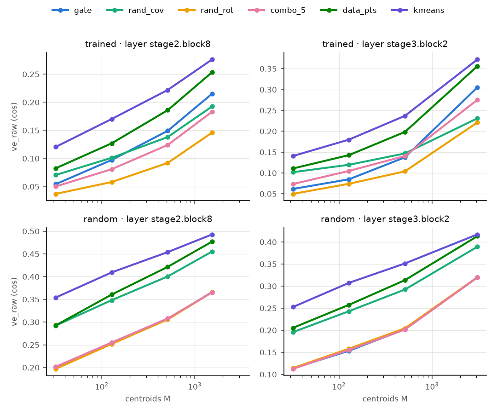
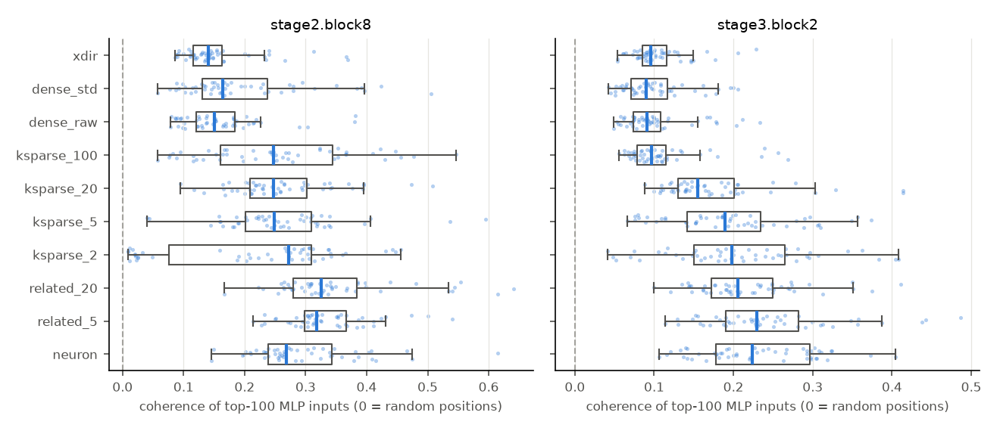

# Experiments A and B on ConvNeXt-tiny (ImageNet-1k val)

*facebook/convnext-tiny-224, blocks stage2.block8 (14×14×1536) and stage3.block2 (7×7×3072), the two blocks with
published CLIP coherence results. Run 2026-10-26 on a Mac (MPS). Code: `scripts/vision_mech.py`. Results:
`results/vision_mech/convnext-tiny-224/` (`centroids/`, `locality/`, `resolve.json`, `clip_*.json`). The language-model
versions are `centroid_experiment_A.md` and `locality_experiment_B.md`; this document only describes what differs.*

## 1. Setup and what had to change

**Data.** The same as the published coherence and purity results: ImageNet-1k validation, 50,000 center crops
(256 → 224). A unit's activation on an image is its **maximum over spatial positions**, and its top images are the 16
(CLIP) or 100 (locality) images with the highest maxima, each at its argmax position. Every image counts once, which
is the vision counterpart of "one per document".

**Neuron and MLP input.** A neuron is a post-GELU hidden coordinate of the block's MLP, as in the microscope. The "MLP
input" `x` is the input of `pwconv1` at each position (after the depthwise conv and LayerNorm), so `W_in[j]·x + b_j` is
exactly neuron j's pre-activation. `W_in` rows play the role of the LM's `W_gate` rows. There is **no `up` set**,
because ConvNeXt's MLP is not gated.

**Reproduction check (done before looking at any result).**
* For every published unit (32 neurons, 32 `virt`, 32 `virt_std` per block), our top-16 images are identical to the
  published microscope's (overlap 1.00 for all three kinds, both blocks).
* The published random directions turned out to come from the original all-blocks extraction order (`all_mlp`), not
  from the `--blocks`-restricted re-extraction in `slurm/vision_sites.sh` (overlap ≤ 0.04 for those orders).
* Our CLIP top-16 coherence reproduces the published per-unit values with Pearson r = 0.985 (mean |difference| 0.010,
  128 units). The small differences come from the published crops being read back from JPEG sprite sheets.
* Our random-crop CLIP baseline is 0.648 / 0.613 (published 0.643 / 0.613).

## 2. Experiment A: neuron input weights as centroids

The exact configuration of the LM results (`09_centroids.py`):
- cosine assignment (primary) plus the Euclidean rule;
- centered and uncentered inputs;
- M ∈ {32, 128, 512, d_ff} with 10 / 10 / 5 / 3 repetitions, and `combo_2/5/20`;
- trained and random-init models;
- the same report code.

The data differs only where it has to:
- **Points.** One random position per image: 50,000 vectors, 25,000 for fitting (even image index) and 25,000 for
  evaluation (odd).
- **Labels.** NMI is computed with the **ImageNet class** (in place of the LM's document label) and the **spatial
  position** (in place of the next token).

### Main results (trained model, centered inputs, cosine assignment)

Values are medians over repetitions, shown as stage2.block8 / stage3.block2.

| M | gate `obj` | rand_rot | combo_20 | rand_cov | data_pts | gate `ve_raw` | rand_rot | rand_cov | gate `nmi_class` | rand_rot | rand_cov | kmeans |
|---|---|---|---|---|---|---|---|---|---|---|---|---|
| 32 | .137 / .090 | .104 / .072 | .126 / .093 | .174 / .197 | .202 / .231 | .054 / .062 | .037 / .050 | .071 / .102 | .019 / .055 | .014 / .057 | .022 / .048 | .060 / .174 |
| 512 | .217 / .160 | .152 / .106 | .186 / .140 | .250 / .263 | .321 / .339 | .149 / .138 | .092 / .104 | .138 / .147 | .010 / .109 | .004 / .023 | .007 / .036 | .020 / .159 |
| d_ff | .244 / .230 | .167 / .123 | .205 / .168 | .273 / .291 | .361 / .423 | **.215 / .305** | .146 / .221 | .193 / .231 | .005 / **.167** | .002 / .011 | .004 / .024 | .012 / .121 |

* **Gate rows beat their rotated copies** (`rand_rot`) on `obj` in all 8 (block, M) cells and in every repetition,
  and on `ve_raw` in all 8. As in the LM, the advantage is **learned**: in the random-init model, `gate`, `rand_rot`,
  `rand_iso` and every `combo_k` agree to within ±0.005 on `obj` and `ve_raw` in every cell.
* **Mixing dilutes it:** gate > combo_2 > combo_5 > combo_20 > rand_rot on `obj` in stage2 at every M, and in stage3
  at M ≥ 512. At small M in stage3 the combos tie or slightly beat the gate rows.
* **On the cosine objective, gate rows trail the covariance-matched random directions** (`obj_norm` −0.17 to −0.22
  in stage2, −0.28 to −0.65 in stage3), the same pattern as the LM.
* **But on variance reduction they overtake them with enough centroids:** at M ≥ 512 in stage2 and at M = 3072 in
  stage3, `ve_raw`(gate) > `ve_raw`(rand_cov) in every repetition.
* **The last block's neurons carve the input by class:** at M = 3072, the gate partition's chance-corrected NMI with
  the ImageNet class is **0.167, above spherical k-means (0.121)**, random data points (0.091) and `rand_cov` (0.024).
  This mirrors the LM's layer 21, where the gate partition carried as much token / next-token information as k-means.
  The mid block (stage2) shows almost no class signal for any set (≤ 0.06), which is expected for mid-level features.

**Euclidean rule.** The gate rows are used at their native norms, rescaled once per set. Neuron norms vary a lot, so a
few large-norm rows capture most points. Under this rule gate rows still beat `rand_rot` on `ve_raw` in 7 / 8 cells,
but fall below isotropic random directions in stage3 (0.103 vs 0.162 at M = 3072). `combo_k` and the random-init
`combo_k` sets behave very differently from their cosine versions (mixing unit rows changes the norm distribution).
So, as in the LM document, the Euclidean numbers mostly measure how centroid norms are distributed. Full tables are in
`centroids/summary_centered.md`. The uncentered variant is in `centroids/summary_raw.md`.

## 3. Experiment B: locality of the top images, and does it explain CLIP coherence?

**Conditions** (50 units each per block; the published units are always included):
- `neuron`;
- `related_5`, `related_20`, `ksparse_2`, `ksparse_5`, `ksparse_20`, `ksparse_100`, built exactly as in combo_interp
  (z-scored inputs, Pearson correlations from 4 random positions per image);
- `dense_raw` = the published `virt` directions and `dense_std` = the published `virt_std` directions (equal-variance
  random combinations; combo_interp's `dense_white` has no published vision counterpart);
- `xdir` = random directions in the MLP-input space.

**Outcomes**, standing in for the agents' `sim_spearman`:
- **CLIP top-16 coherence**, with the same crops and the same CLIP ViT-B/32 as the published microscope;
- **class purity**, the share of the top-16 images from the most common ImageNet class.

**Mediator:** `coh_excess`, the mean pairwise cosine of the centered MLP inputs at the top-100 (image, argmax
position) pairs, minus that of random sets of positions (≈ 0).

### Results

Medians, stage2.block8 / stage3.block2:

| condition | CLIP coherence | class purity | coh_excess | top firings driven by the most common constituent | effective # of driving constituents |
|---|---|---|---|---|---|
| neuron | **.675 / .689** | .125 / .250 | **.27 / .22** | — | — |
| related_5 | .650 / .670 | .125 / .250 | .32 / .23 | .82 / .84 | 1.6 / 1.6 |
| related_20 | .658 / .641 | .125 / .125 | .33 / .21 | .56 / .43 | 3.2 / 4.5 |
| ksparse_2 | .651 / .685 | .125 / .188 | .27 / .20 | 1.00 / 1.00 | 1.0 / 1.0 |
| ksparse_5 | .667 / .704 | .125 / .312 | .25 / .19 | 1.00 / .94 | 1.0 / 1.2 |
| ksparse_20 | .657 / .681 | .125 / .375 | .25 / .16 | .90 / .67 | 1.4 / 2.1 |
| ksparse_100 | .664 / .633 | .125 / .188 | .25 / .10 | .76 / .34 | 2.2 / 6.6 |
| dense_raw (`virt`) | .660 / .610 | .062 / .062 | .15 / .09 | .16 / .10 | 18.6 / 37.8 |
| dense_std (`virt_std`) | .655 / .613 | .125 / .062 | .16 / .09 | .27 / .10 | 13.2 / 41.9 |
| xdir (random input direction) | .648 / .604 | .062 / .062 | .14 / .10 | — | — |
| *random crops* | *.648 / .613* | | *0* | | |

* **Union of regions, now clear.** A dense random combination's top-100 firings are driven by 13–42 *different*
  neurons (the most common one drives only 10–27 % of them). That matches the earlier per-neuron decomposition in the
  README ("dominant neuron differs across 11–16 of 16 images"). Their inputs are barely more coherent than random
  positions, and their CLIP coherence is at the random-crop baseline in stage3.
* **Sparse combinations are neurons at the top.** Heavy tails make `ksparse_2/5` (and `ksparse_20` in stage2) take
  their top images from a single constituent (≥ 90 % of firings). They are as local and as CLIP-coherent as neurons
  (stage3: ksparse_5 0.704 vs neuron 0.689), the same as in the LM. Only `ksparse_100` in stage3 spreads (6.6 drivers)
  and loses coherence (0.633).
* **Per-neuron centroid.** A neuron's `W_in` row is aligned with the mean input of its own top-100 firings 12–13×
  more than a random row (median 13.3 / 12.4; the LM gave 12–15×).
* **A random input-space direction is no better than a dense hidden combination** (coherence 0.14 / 0.10, CLIP at
  baseline). In the LM, random input directions were clearly local (0.14–0.21, below neurons but well above dense
  whitened units). Here only the neurons and the sparse combinations stand out.

**Mediation** (CLIP coherence ~ condition + block, then + `coh_excess`; neuron = reference; 90 % bootstrap CI):

| condition | total effect | direct effect | attenuation |
|---|---|---|---|
| dense_raw | −0.051 [−0.064, −0.037] | −0.008 [−0.021, 0.006] | **0.84** |
| dense_std | −0.048 [−0.063, −0.034] | −0.011 [−0.024, 0.002] | **0.77** |
| ksparse_100 | −0.032 [−0.048, −0.018] | −0.006 [−0.020, 0.009] | **0.82** |
| related_5 | −0.020 [−0.035, −0.005] | −0.029 [−0.043, −0.014] | — (gap grows) |
| related_20 | −0.028 [−0.042, −0.012] | −0.035 [−0.048, −0.020] | — (gap grows) |
| ksparse_2 / 5 / 20 | −0.009 / −0.002 / −0.010 (all CIs include 0) | | — |

* **For the conditions with a clear deficit (dense, k = 100), input-space locality accounts for 77–84 % of the CLIP
  coherence gap, and none of the remaining gaps differ from zero.** That is a stronger result than in the LM (32–60 %
  of the `sim_spearman` gap).
* Within condition, more local units have more coherent top crops (Spearman ρ = 0.37 [0.31, 0.42], n = 900). This
  holds after controlling for class purity (slope +0.215 [0.17, 0.26]), so it isn't only "same class ⇒ same input".
* For class purity, locality accounts for about half of the dense units' deficit (0.52 / 0.47 attenuation; −0.17 →
  −0.08 / −0.09, still nonzero).
* **`related_k` is again the exception:** as local as or more local than neurons, yet slightly *less* CLIP-coherent,
  so adjusting for locality makes its gap larger. The LM's `related_20` showed the same pattern. Grouping correlated
  neurons keeps the region but changes which images rank highest within it.

## 4. Summary in the paper's terms

* **Per-neuron specialization** (a neuron's input weight is the centre of its own firing region): yes, 12–13× above
  chance, the same as in the LM.
* **Weights as cluster centres of the data:** weakly. Gate rows beat their own rotations, the effect is learned, and
  they overtake covariance-matched random directions on variance reduction only with hundreds to thousands of
  centroids. At the last block the neuron partition is more class-informative than k-means.
* **Union of regions as the reason random combinations look worse:** yes. In ConvNeXt-tiny it accounts for most
  (≈ 80 %) of the CLIP coherence gap of dense random combinations. Heavy-tailed neurons make small sparse combinations
  behave like single neurons, which explains why they lose nothing.

**Caveats.**
- One model.
- CLIP coherence is a proxy, not an agent judgement.
- 50 units per condition and block.
- Mediation is correlational.
- The Euclidean rule's results depend mostly on centroid norms (§2).

Base, large, DeiT-small/base and ViT-B/16 are covered by `slurm/vision_mech_all.sh`.
