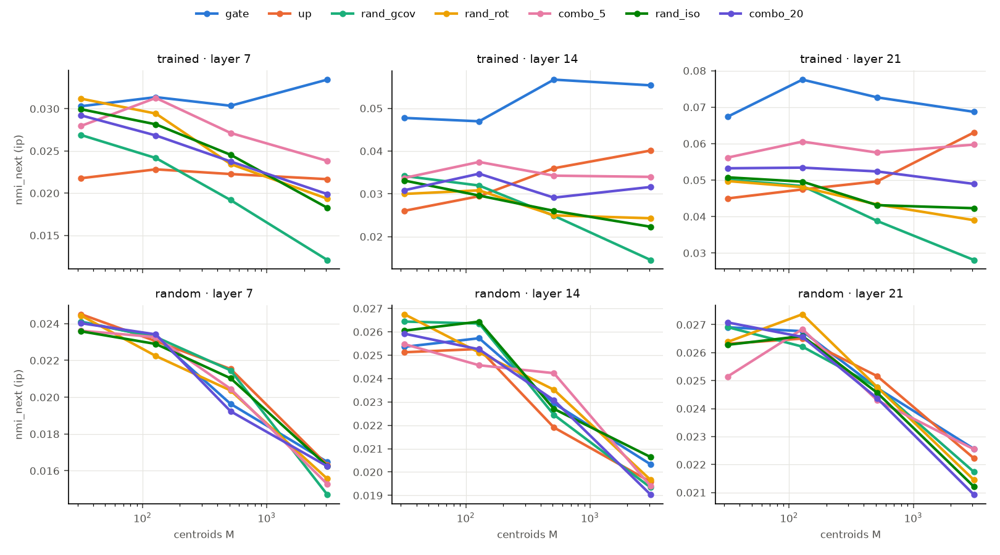
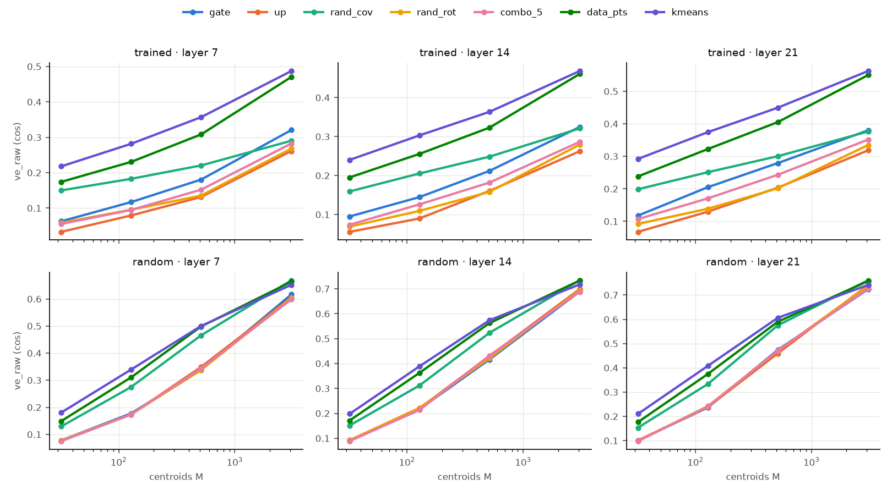

# Experiment A — do neuron weights act as cluster centroids of the MLP input? (Qwen3-0.6B)

*Qwen3-0.6B, layers 7 / 14 / 21, holdout split of `qwen3_0.6b_small_v1`. Run 2026-10-25 (cosine), 2026-10-26
(variance explained, Euclidean and max-inner-product rules). Code: `combo_interp/src/combo_interp/geometry.py`,
`geometry_report.py`, `combo_interp/scripts/09_centroids.py`; raw outputs in
`/Users/rohanbuluswar/combo_runs/qwen3_0.6b_small_v1/data/results/geometry/` (the 2026-10-25 cosine-only results are
kept there as `*/centroids_centered_cosonly_2026-10-25.csv`). The vision version is `vision_convnext_tiny.md`.*

## Summary

Three ways of turning a set of M directions into a partition of the tokens were tried: **max inner product** with
rows at their native norms (each token goes to the neuron with the largest gate pre-activation; the main analysis,
§3–4), **max cosine** (§5) and **Euclidean nearest centroid** (§6).

**Max inner product, uncentered inputs (the network's own pre-activations).** With all 3072 neurons, the gate partition explains 1.3–2.0× the input variance
of the best random null. It is clearly ahead of every null at M ≥ 512: by 3–13 points over the same rows randomly
rotated (`rand_rot`), and by 4–14 points over random directions with **the gate rows' mean and covariance**
(`rand_gcov`). By median it beats `rand_gcov`, `up` and all combinations of gate rows in all 12 (layer, M) cells,
and `rand_rot` in 10. The exceptions are M = 32 at layers 14 and 21, where no partition explains more than 8 %.
The random sets mostly collapse onto the few rows with the largest offsets `c_j·mean(x)`; the gate partition does
not, even though the gate rows' offsets vary at least as much. The gate partition also carries more next-token
information than the random sets in 11–12 of 12 cells. None of this appears in an untrained model.

*Centered x* (which neuron responds most to what is specific to this token): the gate rows
again beat the rotated rows in every cell. The margin at M = 3072 is 1.5–2.3× its size under cosine assignment, and
mixing neurons erodes it in order (k = 2 > 5 > 20, 11 / 12 cells). Here `rand_gcov` catches up on variance explained
with all 3072 centroids, but only through more balanced partitions. It carries a quarter to two-fifths of the gate
partition's next-token information.

**Max cosine and Euclidean.** Used as cluster centroids of the MLP input, the gate rows of a trained Qwen3-0.6B partition tokens
better than random directions with the same internal geometry. The partitions are more informative about the text,
and mixing neurons erodes this. None of it appears in an untrained model. But the gate rows are not the centres of
the input's main clusters: random tokens make much better centroids. All of this holds whether partitions are scored
by mean max-cosine or by variance explained. The one change under variance explained is that the full set of 3072
gate rows ties covariance-matched random directions instead of trailing them. Assigning tokens by Euclidean distance
to the weights at their native norms does not work: the partition collapses onto the shortest weight vectors.

## 1. Why this experiment

Our agent study asks whether single MLP neurons are easier to explain than random linear combinations of neurons
(`ksparse_k`, `dense_*`), with `related_k` as a positive control. If neurons do come out ahead, we want to know *why*.

Abedsoltan, Boix-Adsera, Kalogiannis & Belkin, *Revenge of Monosemanticity* (arXiv 2608.24007), give a candidate
mechanism. They train MLPs on regression data drawn from K clusters, where each cluster has its own predictive
direction. Individual neurons then **specialize**: a neuron's first-layer weight vector mostly points along one cluster's
predictive direction, plus a small "routing" component that puts its firing threshold *inside one cluster*. Each neuron
is therefore a local expert: it is active in one region of input space and linear in a relevant feature there. In
gated MLPs (ReGLU / SwiGLU) the paper credits the gate branch with selecting the cluster and the value branch with
carrying the feature. Their §3.3 shows that the trained first layer encodes the cluster structure: k-means on the
active neurons' representation recovers clusters well enough to fit good local predictors.

Applied to our study, the story would be:

* A neuron fires in **one region** of the MLP input space, so its top activations share one context, and one sentence
  can explain it.
* A random combination of k neurons fires in the **union of k regions**, so it is polysemantic by construction and
  explanations degrade as k grows.
* `related_k` combines neurons that fire together (one region), so it should stay explainable.

That story has two separable ingredients:

* **(A) Mechanical:** combinations are unions of regions. This comes from gating alone and could hold even in an
  untrained network.
* **(B) Learned:** the gate weights are *aligned with real structure in the data*, i.e. they sit on the clusters the
  model's inputs actually form.

**Experiment A tests (B) for the whole set of neurons at once:** used as centroids, do the gate weight vectors
partition the MLP's inputs better than random centroids do? Experiment B (next) tests the per-unit version and links
it to the agents' scores.

## 2. Setup

### Data

* **Tokens.** The 50,178 tokens of the holdout split's cached uniform sample (`cache/holdout/L*/uniform.npz`; position 0
  is excluded, as everywhere in the study). The 450 holdout documents mix web, edu, code and Wikipedia in 7 languages.
* **The vector per token.** `x` = the MLP input at layer L. That is the tensor fed into `gate_proj` (after RMSNorm,
  including its learned scale), captured with a new hook (`MLPCapture(capture_input=True)`). The choice matters:
  `W_gate[j] · x` is *exactly* neuron j's gate pre-activation, so the gate row is the natural "neuron weight" in the
  paper's sense. It is the counterpart of their first-layer weight `w_j`.
* **Fit / evaluation split by document.** Even `seq_id` documents are the *fit* half (used to build the data-derived
  centroids and the covariance); odd documents are the *evaluation* half that every number below is computed on.
  Splitting by document means no centroid is ever evaluated on its own document.
* **Centering.** The cosine results (§5) center x (subtract the fit-half mean) before measuring cosines; without
  this the residual stream's large shared mean dominates every cosine (§5.6). The max-inner-product results use
  uncentered x as their primary variant, because that is the pre-activation the network computes (§3), and centered x
  as a secondary one (§4).

### Centroid sets

Each "centroid set" is M vectors in the 1024-dim MLP-input space (unit-normalized for the cosine rule), with M ∈ {32, 128, 512, 3072}
(3072 = d_ff = all neurons). Random sets are redrawn 10 / 10 / 5 / 3 times for the four values of M.

| set | construction | what it holds fixed / tests |
|---|---|---|
| `gate` | M random rows of `W_gate` | **the test set**: the neurons' own input weights |
| `up` | M rows of `W_up` | the value branch. The paper predicts the gate, not the value, does the routing |
| `rand_iso` | isotropic Gaussian directions | weakest baseline: knows nothing about the data or the weights |
| `rand_rot` | the same gate rows times one random rotation Q | keeps the set's internal geometry (all norms and angles between neurons) but destroys its alignment with the data. **Cleanest null for "aligned with data"** |
| `combo_k` (k = 2, 5, 20) | each centroid a Gaussian-weighted sum of k random unit gate rows | the input-space analogue of our `ksparse_k` units |
| `rand_cov` | Gaussian with the data's covariance, N(0, Σ_x) | random directions that know how stretched the data is in each direction (its anisotropy) |
| `data_pts` | M random tokens' `x` from the fit half | data-aligned random centroids (k-means++-style seeding) |
| `kmeans` | spherical k-means (20 iterations) on the fit half | upper bound: the best M centroids for this objective |
| `rand_gcov` | Gaussian with the mean and covariance of the gate rows | keeps the gate rows' first and second moments, nothing else (max-inner-product rule only) |

### Assignment rules

* **Max cosine** (`cos`): each evaluation token goes to `argmax_j cos(c_j, x)`, with unit-norm centroids.
* **Euclidean** (`euclid`): `argmin_j ‖x − c_j‖²` on the centered `x`, centroids at native relative norms.
  With unit-norm centroids this gives *exactly*
  the cosine partition: ‖x − s·c‖² = ‖x‖² − 2s·c·x + s², so with equal norms the arg-min is the arg-max of c·x. The
  rule therefore only adds something if centroids keep **different norms**. We reuse the sets drawn for the cosine rule
  at their native relative norms (gate / up / rand_rot rows as they are, `combo_k` and Gaussian draws as drawn), scaled
  once per set so the mean centroid norm equals the mean ‖x‖. `data_pts` are the raw tokens (no rescaling), `kmeans` is
  Euclidean (Lloyd) k-means on the raw fit half. Extra metric `dist` = mean squared distance to the nearest centroid
  divided by the mean squared distance to the data mean. Results in §6.
* **Max inner product** (`ip`): token → `argmax_j <c_j, x>`, centroids **not** normalized. For gate rows this is "the
  neuron with the largest gate pre-activation". Two input variants answer different questions:
  * *Uncentered* (**primary**): raw x. The score is the network's own pre-activation `W_gate[j]·x`, and neuron j's
    gate switches at `W_gate[j]·x = 0`. Question: *which neuron does this token drive hardest?*
  * *Centered* (secondary): x − mean(x). The score becomes `W_gate[j]·x − W_gate[j]·mean(x)`, i.e. each neuron's
    constant offset (its response to the average token) is removed. Question: *which neuron responds most to what is
    specific to this token?* This is not what the network computes.

  The cosine analysis uses centered x as its primary variant because *cosine* assignment collapses without it (one
  gate row wins almost every token at L7). That reason is specific to cosine. For max inner product the uncentered
  version is the faithful one, and it does not collapse (§3.2).

Under `ip` a row's norm changes the partition, so every set needs a norm convention:

| set | construction | norms |
|---|---|---|
| `gate` | M random rows of `W_gate` | native |
| `up` | M random rows of `W_up` | native (their own, about 14–15 % relative spread vs 22–28 % for gate) |
| `rand_rot` | the same gate rows × one random rotation | native gate norms; keeps all norms and angles, removes alignment with x. **Cleanest null** |
| `rand_gcov` | N(mean of gate rows, covariance of gate rows) | as drawn: mean norm matches the gate rows, but only ~3 % relative spread |
| `rand_iso` | isotropic Gaussian directions | given the norms of randomly drawn gate rows |
| `combo_k` (k = 2, 5, 20) | Gaussian-weighted sum of k random unit gate rows | given the norms of randomly drawn gate rows |

The data-derived sets (`rand_cov`, `data_pts`, `kmeans`) are points in x-space, not linear functionals, so they have no natural place in this rule and are not included.

### Metrics

Every centroid set and rule gives a partition of the evaluation tokens, which is then scored:

* **`obj`** (cosine only): mean over tokens of the maximum cosine. This is the spherical k-means objective: how close the typical
  token is to some centroid.
* **`obj_norm`** (cosine only) = (obj − obj[`rand_cov`]) / (obj[`kmeans`] − obj[`rand_cov`]). It is 0 at the covariance-matched
  random null and 1 at k-means, so negative means worse than random-with-the-data's-covariance.
* **`ve`** and **`ve_raw`**: the share of variance explained by the partition, 1 − (within-cluster sum of squares /
  total sum of squares), on the evaluation half. Each cluster's spread is measured around the mean of its own
  evaluation tokens, not around the centroid, so this scores the partition itself, not how well the centroid sits
  on it. `ve` uses the unit-normalized centered `x` (directions only), `ve_raw` the centered `x` at its own scale (so
  tokens with large ‖x‖ count more). Primary metric for max inner product (`ve` is within 1 point of `ve_raw` there).
* **`eff_k`**: effective number of clusters actually used, exp(entropy of cluster sizes). This detects degenerate
  partitions where one centroid absorbs everything.
* **Label purity, `nmi_token` / `nmi_next` / `nmi_doc`**: normalized mutual information between the partition and
  (i) the token at that position, (ii) the next token, (iii) a coarse document label (code / ja / ru / bn / de / fr / es
  / en / other). We report the NMI *minus* the NMI of a random partition with identical cluster sizes. Plain NMI rises
  mechanically with the number and balance of clusters; subtracting this chance level removes most of that bias, so
  the result measures "how much does this partition know about the text".
  The document labels come from a content heuristic (script detection, stopword counts, code-symbol density): the
  corpus does not store each document's source, and the corpus builder's mixing order cannot be replayed (it breaks
  ties by set-iteration order, which depends on Python's per-run hash seed). Label shares (tokens): en 35.2k,
  code 3.2k, es 2.2k, fr 2.0k, other 1.8k, de 1.6k, ja 1.6k, ru 1.6k, bn 1.0k.

### Controls

* **Random-init model.** Same architecture, untrained weights (`AutoModelForCausalLM.from_config`, seed 0), run
  through the whole pipeline. Anything that also appears here comes from architecture or geometry, not learning.
* **Uncentered variant** (`--set geometry.center=false`): raw `x`. Primary for max inner product (§3), a robustness
  check for cosine (§5.6). Qwen has no MLP biases, so `W_gate[j]·x` on raw `x` is exactly the gate pre-activation.

### Pre-stated predictions

If neuron weights are learned cluster centroids as in the paper, then:

1. `gate` > `rand_rot`, `rand_iso` (alignment with the data, not just set geometry);
2. `gate` > `combo_2` > `combo_5` > `combo_20` (combining dilutes alignment);
3. `gate` ≥ `rand_cov` and close to `data_pts` (the weights sit on the dominant clusters);
4. `gate` > `up` (the gate routes);
5. none of this in the random-init model.

The predictions were stated for the cosine analysis; §3–4 apply 1, 2, 4 and 5 to max inner product.

## 3. Max inner product, uncentered inputs (the network's own pre-activations; primary)

### 3.1 Variance explained

`ve_raw` (%), trained model, L7 / L14 / L21:

| M | gate | up | rand_gcov | rand_rot | rand_iso | combo_2 | combo_5 | combo_20 |
|---|---|---|---|---|---|---|---|---|
| 32 | 4.7 / 5.2 / 6.6 | 3.0 / 5.0 / 5.0 | 3.3 / 3.6 / 6.0 | 4.5 / **5.4 / 7.9** | 4.0 / 4.6 / 7.5 | 2.4 / 4.1 / 5.3 | 2.6 / 3.0 / 4.7 | 2.8 / 3.5 / 4.3 |
| 128 | **9.5 / 9.1 / 10.5** | 5.3 / 7.4 / 5.6 | 5.7 / 6.4 / 8.4 | 6.7 / 6.9 / 10.3 | 6.0 / 6.5 / 10.5 | 3.6 / 3.3 / 5.1 | 3.3 / 1.7 / 7.7 | 3.4 / 5.2 / 6.3 |
| 512 | **15.0 / 12.8 / 18.4** | 7.0 / 12.2 / 7.8 | 7.7 / 8.9 / 12.2 | 8.9 / 9.6 / 13.0 | 9.0 / 8.1 / 13.3 | 3.7 / 1.9 / 4.9 | 5.1 / 5.2 / 11.3 | 4.7 / 4.1 / 5.5 |
| 3072 | **25.7 / 20.9 / 27.1** | 1.7 / 15.6 / 11.7 | 12.0 / 12.1 / 15.4 | 12.7 / 10.9 / 17.4 | 11.3 / 11.9 / 17.3 | 3.1 / 2.6 / 6.5 | 7.0 / 3.1 / 10.6 | 5.9 / 6.2 / 11.6 |

Gate vs each null, out of 12 cells. "Median" = the gate median is higher. "Every rep" = every gate repetition beats
every repetition of the null.

| null | median | every rep |
|---|---|---|
| `rand_rot` | 10 (loses at M = 32, L14 −0.2 and L21 −1.3) | 5 (M = 512 at L7 and L21; M = 3072 at every layer) |
| `rand_iso` | 11 | 5 |
| `rand_gcov` | **12** (by 0.6–13.7 points) | 6 |
| `up` | 12 | — |
| `combo_2` / `combo_5` / `combo_20` | 12 / 12 / 12 | 7 / 7 / 9 |

Gate − `rand_rot`, points of `ve_raw`:

| M | L7 | L14 | L21 |
|---|---|---|---|
| 32 | +0.2 | −0.2 | −1.3 |
| 128 | +2.8 | +2.2 | +0.2 |
| 512 | +6.1 | +3.2 | +5.4 |
| 3072 | **+13.0** | **+10.0** | **+9.7** |

* **With all neurons, the gate partition is clearly the best,** explaining 2.0 / 1.3 / 1.6× the variance of the best
  null at M = 3072 (`rand_rot` at L7 and L21, `up` at L14).
* **The advantage is a property of many neurons together.** It is absent at M = 32, where all partitions are within
  the repetition spread. It grows steadily with M and is unanimous across repetitions only at M ≥ 512.


*Top: trained. Bottom: random init. In the trained model the gate line (blue) separates from all nulls as M grows.
In the random-init model all sets coincide.*

### 3.2 The random sets collapse, the gate rows do not

Without centering, each row's score includes a constant offset `c_j·mean(x)`, the same for every token. The mean
input is large (its norm is 0.50–0.59 of the typical ‖x‖), so these offsets are large.

Effective number of clusters at M = 3072, L7 / L14 / L21:

| gate | up | rand_gcov | rand_rot | rand_iso | combo_2 | combo_5 | combo_20 |
|---|---|---|---|---|---|---|---|
| **339 / 151 / 98** | 2.4 / 44 / 21 | 142 / 58 / 58 | 137 / 79 / 125 | 88 / 91 / 127 | 4.4 / 3.5 / 8.4 | 18 / 4.0 / 16 | 25 / 8.5 / 31 |

* **For random rows, the offsets decide the partition.** With the rotated rows (`rand_rot`, M = 3072), the 30 rows
  with the largest offsets take 30 % / 66 % / 42 % of all tokens (L7 / L14 / L21). This diagnostic uses one random
  rotation and all 50k tokens, separately from the main runs.
* **For the gate rows they do not.** The 30 gate rows with the largest offsets take only 2 % / 21 % / 19 % of tokens.
  Yet the gate rows' offsets vary *more* than the rotated rows' (standard deviation over rows 0.76 / 0.86 / 1.60 vs
  0.63 / 0.50 / 0.87), and about as much as the token-specific part of the score. Training has arranged the rows so
  that the largest pre-activation still depends on the token, not on a few always-dominant neurons.
* **Comparison with cosine.** Under cosine assignment on the same uncentered x (§5.6) the gate
  partition collapsed to 1 / 10 / 14 effective clusters. Keeping the native norms is what avoids the collapse.
* The up rows collapse at L7 (2.4 effective clusters, 1.7 % variance). The combinations collapse at every layer and
  fall below even `rand_iso` in all 12 cells. Their ordering in k is therefore noise here (gate > combo_2 > combo_5 >
  combo_20 in only 1 / 12 cells), and the dose-response is better read from the centered analysis (§4.1).

### 3.3 What the partitions know about the text

Chance-corrected NMI, trained, M = 3072, L7 / L14 / L21:

| set | `nmi_token` | `nmi_next` | `nmi_doc` |
|---|---|---|---|
| gate | **.083** / .076 / **.121** | **.032** / .042 / **.083** | **.058 / .054 / .151** |
| up | .033 / **.098** / .103 | .002 / **.053** / .059 | .019 / .050 / .099 |
| rand_gcov | .059 / .053 / .080 | .021 / .023 / .045 | .043 / .037 / .093 |
| rand_rot | .066 / .045 / .071 | .028 / .027 / .051 | .054 / .051 / .087 |
| rand_iso | .062 / .047 / .067 | .026 / .027 / .046 | .055 / .049 / .086 |
| combo_2 | .018 / .012 / .046 | .009 / .017 / .033 | .019 / .013 / .064 |
| combo_5 | .062 / .022 / .060 | .019 / .016 / .047 | .036 / .017 / .079 |
| combo_20 | .052 / .039 / .073 | .022 / .022 / .053 | .047 / .027 / .088 |

* Across all 12 cells, the gate median on `nmi_next` beats `rand_gcov` and every combination in 12, `rand_rot` and
  `rand_iso` in 11, and `up` in 10.
* At M = 3072 the gate partition carries 1.1 / 1.6 / 1.6× the next-token information of the rotated rows, and the
  most document information of any set at every layer (.151 at L21).
* At L14 the up rows carry more current- and next-token information than the gate rows (.098 vs .076, .053 vs .042),
  although they explain less variance. That fits the cosine finding (§5.5) that `up` rows rival `gate` rows on
  label purity at large M.

## 4. Max inner product, centered inputs (token-specific drive; secondary)

Here each neuron's response to the average token is subtracted before taking the argmax.

### 4.1 Variance explained

`ve_raw` (%), trained model, L7 / L14 / L21:

| M | gate | up | rand_gcov | rand_rot | rand_iso | combo_2 | combo_5 | combo_20 |
|---|---|---|---|---|---|---|---|---|
| 32 | **6.0 / 8.8 / 11.2** | 3.2 / 5.4 / 6.6 | 4.9 / 6.8 / 9.2 | 5.5 / 5.9 / 8.7 | 5.4 / 6.5 / 8.2 | 5.3 / 7.1 / 10.4 | 5.0 / 6.6 / 9.3 | 4.9 / 6.3 / 9.1 |
| 128 | **10.4 / 12.3 / 19.4** | 6.5 / 8.4 / 12.0 | 7.9 / 11.0 / 13.8 | 8.5 / 8.6 / 11.7 | 7.9 / 8.5 / 12.3 | 8.6 / 10.3 / 16.0 | 8.3 / 10.0 / 15.1 | 7.5 / 9.5 / 13.9 |
| 512 | **16.0 / 17.6 / 25.9** | 9.4 / 15.0 / 19.0 | 12.4 / 15.7 / 20.2 | 11.3 / 11.3 / 16.8 | 11.3 / 10.8 / 15.6 | 13.8 / 14.0 / 21.3 | 12.6 / 13.3 / 20.3 | 11.3 / 11.8 / 18.7 |
| 3072 | 25.7 / 24.2 / 32.5 | 17.3 / 25.3 / 31.6 | 25.4 / **28.0 / 33.1** | 17.8 / 14.9 / 22.2 | 17.6 / 15.0 / 21.6 | 22.5 / 18.7 / 30.0 | 21.1 / 19.0 / 27.4 | 18.6 / 16.8 / 24.7 |

| null | median (of 12) | every rep (of 12) |
|---|---|---|
| `rand_rot` | **12** (by 0.5–10.3 points) | 9 (not M = 32 at L7 and L21; M = 128 at L14) |
| `rand_iso` | 12 | 10 |
| `rand_gcov` | 10 (loses at M = 3072, L14 −3.8 and L21 −0.6; ties at L7 +0.3) | 6 |
| `up` | 11 (loses at M = 3072, L14) | — |
| `combo_2` / `combo_5` / `combo_20` | 12 / 12 / 12 | 7 / 7 / 8 |

* **Gate rows beat the rotated rows in every cell,** from +0.5 / +2.9 / +2.5 points at M = 32 to
  +7.9 / +9.3 / +10.3 at M = 3072. Under cosine assignment the same comparison gave +5.3 / +4.5 / +4.5 at M = 3072
  (§5.7). Keeping the native norms makes the gate's advantage 1.5–2.3× larger.
* **Dilution is orderly:** gate > combo_2 > combo_5 > combo_20 in 11 / 12 cells (at M = 3072, L14, combo_5 is 0.3
  points above combo_2), cleaner than under cosine assignment (8 / 12). Unlike the uncentered case, the combinations
  do not collapse here, so this is where the dose-response can be read.
* **Partitions are coarser than under cosine:** 311 / 200 / 328 effective clusters for gate at M = 3072, against
  791 / 769 / 494. Larger-norm rows win more tokens.


### 4.2 The gate-covariance null catches up, through balance

`rand_gcov` keeps everything about the gate rows that a Gaussian can: their mean and their full 1024 × 1024
covariance (participation ratio 528–618 of 1024 dimensions, so far from isotropic). It loses everything beyond
second order, and the identity of individual rows. Up to M = 512 the gate rows beat it in every cell (by 1.1–5.7
points). At M = 3072 it ties at L7 and wins at L14 and L21. Two observations say this is not because it captures
the data's structure better:

* **It partitions much more evenly.** At M = 3072 its effective cluster count is 1954 / 1546 / 1374, against
  311 / 200 / 328 for gate. A Gaussian draw in 1024 dimensions has nearly constant norm (~3 % relative spread vs
  22–28 % for gate rows), so under `ip` it behaves almost like cosine assignment and spreads tokens over many cells.
  Finer, more even partitions explain more variance almost automatically.
* **It knows little about the text.** At M = 3072 its partition carries .012 / .015 / .028 next-token information,
  against .033 / .055 / .069 for gate, less than every other set.

In the uncentered analysis, where the offsets stay in, `rand_gcov` loses to the gate rows in every cell (§3.1).

### 4.3 What the partitions know about the text

Chance-corrected NMI, trained, M = 3072, L7 / L14 / L21:

| set | `nmi_token` | `nmi_next` | `nmi_doc` |
|---|---|---|---|
| gate | **.081 / .129 / .135** | **.033 / .055** / .069 | **.069 / .077** / .132 |
| up | .051 / .069 / .102 | .022 / .040 / .063 | .032 / .046 / .109 |
| rand_gcov | .031 / .032 / .052 | .012 / .015 / .028 | .037 / .036 / .079 |
| rand_rot | .050 / .044 / .063 | .019 / .024 / .039 | .051 / .051 / .081 |
| rand_iso | .050 / .046 / .063 | .018 / .022 / .042 | .049 / .047 / .084 |
| combo_2 | .074 / .076 / .103 | .027 / .048 / **.070** | .058 / .052 / .127 |
| combo_5 | .064 / .061 / .088 | .024 / .034 / .060 | .052 / .055 / **.132** |
| combo_20 | .047 / .056 / .075 | .020 / .032 / .049 | .047 / .049 / .097 |

* Across all 12 cells, the gate median on `nmi_next` beats `rand_iso`, `rand_gcov`, `up`, `combo_5` and `combo_20`
  in 12, and `rand_rot` and `combo_2` in 11.
* At L14 the gate partition carries 2.3–2.9× the next-token and token information of the rotated rows. With the
  offsets removed, the gate partitions are more informative about the current token than in the uncentered
  analysis (.129 vs .076 at L14).



### 4.4 Random-init control (both input variants)

Same architecture, untrained weights, run through the same pipeline. No set stands out. Uncentered, gate −
`rand_rot` ranges from −1.5 to +0.3 points of `ve_raw`, and all eight sets agree to within 3.0 points in every cell.
Centered: −0.8 to +1.3, within 2.9. Effective cluster counts and all three NMIs are the same across sets. Gate beats
`rand_rot` in every repetition in 0 (uncentered) and 1 (centered) of 12 cells. Everything in §3–4 is learned.

## 5. Max cosine assignment

The original analysis (2026-10-25), on centered x, scored first by mean max-cosine and then by variance explained.

Cosine assignment; 12 cells = 3 layers × 4 values of M.

| prediction | scored by `obj` (max-cosine, §5.1–5.3) | scored by `ve` (variance explained, §5.7) |
|---|---|---|
| 1. gate beats geometry-matched random sets | **Yes.** Every gate repetition beats every `rand_rot` repetition in all 12 cells | **Yes.** All 12 cells by median (+0.5 to +7.6 points); every repetition in 10 / 12 (not at M = 32, L7 and L21) |
| 2. dilution with k | **Yes.** Monotone at every layer for M ≥ 128 | **Mostly.** gate > combo_2 in all 12 cells; full order gate > combo_2 > combo_5 > combo_20 in 8 / 12 |
| 3. gate sits on the dominant clusters | **No.** Far below `rand_cov` (obj_norm −0.6 to −0.8) and `data_pts` | **No.** Below `rand_cov` by 2–9 points at M ≤ 512, ties it at M = 3072; below `data_pts` in all 12 cells (by 13.5–16.8 points at M = 3072) |
| 4. gate > up | **Yes** in all 12 cells. **No** on label purity at large M, where `up` ties or wins | **Yes** in all 12 cells |
| 5. nothing in the random-init model | **Yes.** All weight-based sets indistinguishable from random | **Yes.** gate − rand_rot between −1.4 and +1.4 points, with no consistent sign |

The Euclidean rule (§6) is not in this table: with the weights at their native norms it measures how the norms are
distributed, not alignment with the data.

So neuron weights are **learned, data-aligned partitioners, but of low-variance directions, not of the data's main
cluster structure**.

### 5.1 Gate rows vs geometry-matched nulls (trained model)

`obj` (mean max-cosine on the evaluation half), median over repetitions:

| M | layer | gate | combo_2 | combo_5 | combo_20 | rand_rot | rand_iso | up |
|---|---|---|---|---|---|---|---|---|
| 32 | 7 / 14 / 21 | .071 / .077 / .074 | .066 / .071 / .068 | .065 / .068 / .067 | .064 / .068 / .064 | .064 / .065 / .064 | .064 / .064 / .064 | .059 / .064 / .059 |
| 128 | 7 / 14 / 21 | .097 / .104 / .110 | .086 / .094 / .093 | .085 / .091 / .088 | .081 / .086 / .083 | .081 / .081 / .080 | .081 / .081 / .081 | .080 / .082 / .077 |
| 512 | 7 / 14 / 21 | .122 / .131 / .139 | .109 / .118 / .115 | .102 / .111 / .110 | .097 / .103 / .099 | .094 / .095 / .095 | .095 / .095 / .095 | .097 / .105 / .102 |
| 3072 | 7 / 14 / 21 | .159 / .160 / .176 | .137 / .143 / .153 | .128 / .134 / .137 | .115 / .122 / .120 | .110 / .110 / .111 | .111 / .111 / .111 | .126 / .137 / .134 |

* `gate` beats `rand_rot` in **all 12 (layer, M) cells, in every repetition**. The rotation keeps every norm and angle
  inside the set, so the difference can only come from where the set points relative to the data.
* The gap is small for few centroids (+10–20 % at M = 32) and grows with M (+45–60 % at M = 3072). Each neuron covers
  only a small part of the inputs, so the benefit appears when many neurons are used together.
* **Dilution is monotone:** gate > combo_2 > combo_5 > combo_20 ≈ rand_rot at every layer and M ≥ 128. A combination
  of 20 neurons has lost essentially all its alignment with the data. This parallels the k-dose-response design of
  the agent study, here measured in the input space instead of by explanation quality.
* The absolute numbers are low (a typical token has cosine ≈ 0.1–0.18 with its best neuron) because the centered
  1024-dim inputs are spread out. Only the comparisons between sets carry meaning.

### 5.2 Random-init control

In the untrained model, `gate`, `up`, `rand_rot`, `rand_iso` and all `combo_k` sets agree to within ±0.001 at every
layer and M (e.g. 0.110–0.111 at M = 3072). They also agree on every purity metric. Random weights are just random
directions, so **everything in 5.1 is learned.** The data-derived sets (`rand_cov`, `data_pts`, `kmeans`) still beat
them, because even an untrained network's inputs are anisotropic and clustered (token embeddings pass through).


*Top row: trained. Bottom row: random init. In the trained model the blue gate line separates from the orange/pink
random-geometry lines. In the random-init model they coincide. In both, the data-derived sets (`rand_cov` green,
`data_pts` dark green, `kmeans` violet) are far above.*

### 5.3 Gate rows vs data-derived centroids: prediction 3 fails

`obj_norm` (0 = `rand_cov`, 1 = `kmeans`), trained model:

| M | gate (L7 / L14 / L21) | rand_rot | data_pts |
|---|---|---|---|
| 32 | −0.62 / −0.64 / −0.70 | −0.65 / −0.69 / −0.74 | +0.20 / +0.20 / +0.25 |
| 3072 | −0.59 / −0.81 / −0.77 | −0.77 / −1.03 / −1.01 | +0.66 / +0.61 / +0.70 |

Gate rows close only a small part of the gap between random rotations and covariance-matched random directions. Even
32 random tokens used as centroids do far better.

**Why:** a diagnostic computed on the trained inputs. For each direction *w*, take the variance of the inputs along
*w*, divided by the average variance per dimension (median over the set):

| layer | gate | up | isotropic | rand_cov | principal components holding 50 % of the variance |
|---|---|---|---|---|---|
| 7 | 0.91 | 0.75 | 0.97 | 11.2 | 102 / 1024 |
| 14 | 0.99 | 0.81 | 0.96 | 13.0 | 61 / 1024 |
| 21 | 0.88 | 0.67 | 0.95 | 17.2 | 39 / 1024 |

The MLP input is strongly anisotropic: a few dozen principal directions hold half the variance. A direction drawn from
the data's covariance points mostly along them, so it is close (in cosine) to many tokens. **Gate rows are no more
aligned with the high-variance directions than a random isotropic direction is** (up rows even less so). The neurons
read directions in which the inputs vary *little*. Their advantage over random (5.1) comes from *which* low-variance
directions they pick, not from tracking the dominant variation.

This is the main way the LM differs from the paper's toy setting. There, the cluster means are the dominant variation
(separation R ≫ within-cluster noise), so a specialized neuron necessarily has a routing component pointing at its
cluster's mean. Here the dominant variation (presumably large-scale directions such as position-like, language-like
and outlier dimensions) is not what individual neurons encode.

Consistent with that, gate neurons are selective but not tiny: the share of tokens with a positive gate pre-activation
(uncentered `x`, i.e. what the network computes) has median 7.8 % at layer 7, 36.8 % at layer 14 and 14.7 % at layer 21.

### 5.4 What the partitions know about the text (label purity)

Chance-corrected NMI, trained model, centered, M = 3072 (L7 / L14 / L21):

| set | `nmi_token` | `nmi_next` | `nmi_doc` |
|---|---|---|---|
| gate | .076 / .074 / **.117** | .025 / .035 / **.068** | .055 / .056 / .118 |
| up | .065 / .084 / .101 | .028 / .047 / .075 | .049 / .053 / .131 |
| rand_rot | .036 / .029 / .048 | .013 / .012 / .027 | .043 / .041 / .074 |
| combo_20 | .045 / .047 / .074 | .016 / .021 / .041 | .043 / .044 / .100 |
| rand_cov | .088 / .082 / .089 | .041 / .045 / .067 | .101 / .090 / .140 |
| data_pts | .103 / .076 / .098 | .032 / .031 / .049 | .084 / .079 / .123 |
| kmeans | .126 / .098 / .115 | .039 / .039 / .058 | .097 / .092 / .136 |

* Against `rand_rot`, gate partitions carry **2–3× more information** about the current and next token, and more
  about the document type. That is real, learned, text-relevant structure.
* **At layer 21 with all 3072 neurons, the gate partition knows as much about the current and next token as k-means
  does** (.117 vs .115; .068 vs .058), and more than `rand_cov` and `data_pts`, even though it scores far worse on the
  geometric objective. Late-layer neurons carve the input along token- and prediction-relevant lines rather than along
  directions of maximal variance. At layers 7 and 14, and for the coarse document label at every layer, the
  data-derived sets still win.
* At small M (32), gate partitions are only slightly better than random on purity (e.g. `nmi_next` at L21: gate .067,
  rand_rot .052, rand_cov .100).


### 5.5 Gate vs up

On the geometric objective, `gate` > `up` in the median of all 12 cells, and in every repetition in 11 of them (the
exception is L7, M = 32), as the paper's
gate-routes / value-carries story predicts. On label purity at M = 3072 the up rows tie or beat the gate rows
(e.g. `nmi_doc` L21: .131 vs .118; `nmi_next` L14: .047 vs .035), so the split of roles is at best partial in a real LM.

### 5.6 Uncentered inputs

Without centering, a handful of gate rows that align with the mean input absorb almost every token. The effective
number of clusters used by the gate partition at M = 3072 is 1.2 / 9.7 / 14.0 (L7 / L14 / L21), against 790 / 770 / 495 when
centered and 230–440 for `rand_rot`. The gate set's `obj` still beats `rand_rot` at M ≥ 512, but its purity numbers
are meaningless (near-empty partitions). This variant is reported for completeness only. The centered analysis is the
primary one, and that choice was made before any results were seen.

### 5.7 Variance explained by the cosine partitions

Max-cosine (`obj`) rewards a set for having *some* centroid close to each token. It does not ask whether the tokens
sharing a centroid are close to *each other*, which is what "cluster" means. `ve` / `ve_raw` measure that directly.
Trained model, same partitions as §5.1, median over repetitions, % of variance explained, L7 / L14 / L21:

| M | metric | gate | up | combo_2 | combo_20 | rand_rot | rand_cov | data_pts | kmeans |
|---|---|---|---|---|---|---|---|---|---|
| 32 | `ve` | 6.3 / 9.4 / 11.4 | 3.3 / 5.6 / 6.6 | 5.5 / 7.5 / 10.4 | 5.2 / 7.2 / 9.4 | 5.8 / 6.8 / 8.8 | 14.7 / 15.7 / 19.1 | 17.2 / 19.1 / 22.9 | 21.7 / 23.7 / 28.4 |
| 128 | `ve` | 11.7 / 14.3 / 19.8 | 7.9 / 9.0 / 12.6 | 9.5 / 12.4 / 17.1 | 8.6 / 11.6 / 15.3 | 9.4 / 10.8 / 13.3 | 18.1 / 20.2 / 24.4 | 22.9 / 25.2 / 31.3 | 28.1 / 30.0 / 36.5 |
| 512 | `ve` | 17.9 / 20.9 / 27.1 | 13.0 / 15.9 / 19.7 | 16.2 / 18.9 / 23.6 | 14.0 / 16.9 / 21.8 | 13.4 / 15.6 / 19.5 | 22.0 / 24.6 / 29.4 | 30.7 / 31.9 / 39.6 | 35.6 / 35.9 / 44.0 |
| 3072 | `ve` | 31.7 / 32.0 / 37.3 | 25.8 / 25.9 / 31.1 | 27.7 / 27.8 / 34.2 | 27.4 / 29.0 / 34.3 | 26.6 / 27.7 / 32.8 | 29.1 / 32.0 / 37.1 | 46.8 / 45.5 / 54.1 | 48.4 / 46.2 / 55.3 |
| 3072 | `ve_raw` | 32.1 / 32.5 / 38.0 | 26.1 / 26.2 / 31.8 | 28.3 / 28.1 / 35.0 | 27.7 / 29.4 / 34.8 | 26.8 / 28.0 / 33.5 | 29.0 / 32.1 / 37.6 | 47.1 / 46.1 / 55.0 | 48.7 / 46.8 / 56.2 |

* `ve_raw` is within ~1 point of `ve` everywhere (all cells in the CSV), so weighting tokens by their norm changes
  nothing.
* Predictions 1, 2 and 4 survive. The gate median beats `rand_rot` in all 12 cells, by 0.5–7.6 points (largest at
  L21, M = 512), and every gate repetition beats every `rand_rot` repetition in 10 of 12 (exceptions: M = 32 at L7
  and L21; same for `ve_raw`). As with `obj`, the gap grows with M until M = 512. `gate` > `up` in all 12. The full
  dilution order gate > combo_2 > combo_5 > combo_20 holds in 8 / 12 cells for `ve` (9 / 12 for `ve_raw`); gate >
  combo_2 holds in every cell, the misorderings are among the combos.
* **Prediction 3 is less clear-cut than on `obj`.** At M ≤ 512 gate rows are still well below `rand_cov`. With all
  3072 rows they tie it (31.7 vs 29.1, 32.0 vs 32.0, 37.3 vs 37.1), while `obj_norm` put them far below. They never
  approach `data_pts` or `kmeans`, so the conclusion that gate rows are not centres of the data's main clusters stands.
* Random-init model: as in §5.2, the weight-based sets do not separate. Their medians agree to within 0.3–2.4 points
  (the spread grows with M), gate − rand_rot ranges from −1.4 to +1.4 points with no consistent sign, and the best
  data-derived set is 2–16 points above all of them. Partitions of the untrained inputs explain much more variance overall
  (e.g. 60–76 % at M = 3072, against 26–56 % trained): those inputs have more concentrated, easier-to-cluster
  structure.



## 6. Euclidean assignment with raw-scale centroids

`ve_raw` (%) under the Euclidean rule (§2, assignment rules), trained model, L7 / L14 / L21:

| M | gate | up | combo_2 | combo_20 | rand_rot | rand_iso | rand_cov | data_pts | kmeans |
|---|---|---|---|---|---|---|---|---|---|
| 32 | 0.5 / 2.1 / 2.4 | 0.2 / 1.6 / 0.9 | 0.2 / 0.6 / 0.7 | 0.6 / 1.1 / 2.2 | 0.6 / 0.6 / 2.4 | 4.5 / 5.4 / 7.3 | 14.6 / 15.6 / 19.7 | 16.0 / 18.2 / 23.4 | 22.0 / 24.3 / 30.0 |
| 3072 | 1.2 / 1.4 / 10.0 | 4.7 / 6.4 / 8.6 | 8.0 / 10.5 / 14.2 | 0.5 / 3.1 / 7.0 | 0.0 / 3.4 / 7.1 | 17.6 / 19.0 / 23.1 | 30.1 / 32.9 / 38.9 | 45.2 / 44.8 / 54.4 | 46.6 / 44.8 / 55.5 |

**The weight-based partitions collapse.** At M = 3072 the gate and `rand_rot` partitions use 1–10 effective clusters
(cosine rule: ~500–1900). The cause is the norm term. Nearest centroid = argmax c·x − ‖c‖²/2, and once the centroids
are scaled to the data's norm the spread of ‖c‖²/2 across gate rows (sd ≈ 150 / 245 / 730 at L7 / L14 / L21) is
10–20× larger than a typical |c·x| (≈ 18 / 12 / 57), because the cosines are only ~0.1. So the partition simply
ranks rows by norm: the 10 shortest gate rows take 100 % / 99 % / 86 % of the tokens. The same happens to `up`,
`rand_rot` and `combo_k`, and to the random-init model's `combo_k` sets, whose norms vary a lot. `rand_iso` and
`rand_cov`, whose norms vary less, degrade less. The data-derived sets are unaffected because their norms are the
data's own.

So this rule does not test alignment; it tests the distribution of weight norms, and the differences between sets in
the table are artifacts of that. The comparison between weight sets is only meaningful with equal norms, and then it
is identical to the cosine rule in §5.1 and §5.7. (A smaller global scale moves the rule towards argmax c·x with
native norms, i.e. "which neuron has the largest gate pre-activation": that is the max-inner-product rule of §3–4.)

## 7. Interpretation

### Max inner product

* **In the network's own terms, each token's most strongly driven neuron reveals learned structure.** With the
  uncentered pre-activations, the trained gate rows partition the inputs into groups that are more compact and more
  informative about the text than any random set: the same rows rotated, random directions with their mean and
  covariance, or mixtures of them. This only shows when many neurons are used together.
* **The offsets matter, and training has handled them.** Random rows with large offsets `c·mean(x)` absorb most
  tokens. Gate rows have offsets that are at least as large, yet the winning neuron still depends on the token. One
  reading: neurons are organized so that their constant responses to the average token do not drown out their
  token-specific responses. This is also why the network-faithful partition does not collapse even though the
  centered cosine analysis needed centering to avoid collapse.
* **Second-order statistics of the gate rows are not enough.** Random directions with the gate rows' mean and
  covariance lose to them in every uncentered cell. In the centered analysis they match on variance explained only
  through more balanced partitions, carrying a quarter to two-fifths of the gate's next-token information.
* **Combining neurons dilutes the structure.** In the centered analysis, where the mixtures do not collapse, this is
  monotone in k (11 / 12 cells): the input-space counterpart of the `ksparse_k` dose-response in the agent study.
  Uncentered, mixtures of gate rows are worse than isotropic random directions.
* **Remaining limit.** This is a winner-take-all view: one neuron per token. The paper's claim is per neuron (each
  neuron fires within one cluster), and many neurons fire per token. A cluster served by many neurons appears here
  as a fine refinement, which the symmetric NMI penalizes.

### Max cosine and Euclidean

**What Experiment A supports.**
* MLP gate weights are not arbitrary directions: training aligns them with the input distribution, and the resulting
  partition is informative about tokens, next tokens and document type. On max-cosine this holds at every layer and
  set size and in every repetition. On variance explained it holds in every cell by median and in every repetition
  except at the smallest sets (M = 32, L7 and L21). It is absent at initialization.
* Mixing neurons destroys this alignment gradually: `combo_2` keeps part of it, `combo_20` almost none. That is the
  qualitative pattern the paper's mechanism predicts for our `ksparse_k` dose-response. The ordering among the combos
  is noisier on variance explained than on max-cosine.
* The conclusions do not hinge on the choice of metric. Max-cosine asks "is every token near *some* centroid";
  variance explained asks "are tokens that share a centroid near *each other*". The two correlate only moderately
  across all rows (r = 0.44), yet they agree on the outcome of every prediction (prediction 2 less cleanly on
  variance explained).

**What it does not support.**
* The strong form of the paper's picture, "each neuron's weight vector is the centre of a data cluster", does not hold
  in Qwen3-0.6B. Gate rows are far from the dominant structure of the inputs (they carry no more input variance than a
  random direction), and random tokens make much better cluster centres. Variance explained softens this only for the
  full set: all 3072 gate rows partition the inputs as well as 3072 covariance-matched random directions, but still
  explain 13.5–16.8 points less variance than 3072 random tokens.
* So if neurons are more explainable than combinations, it is **not** because each neuron owns one of the big,
  obvious clusters of the residual stream. A better reading is that neurons pick out *specific low-variance features*
  that are well aligned with linguistic structure (most clearly at layer 21). This is closer to the paper's "local
  predictive feature" than to its "routing to a cluster".

**What Experiment A cannot say.**
* It evaluates **the set of neurons as a partition**. The agents explain **one unit at a time**, by its top
  activations. A unit can be locally coherent (its top-activating tokens share one context) without the set of all
  neurons forming good global clusters, and vice versa.
* It lives in the **MLP input space** (`x`), while our units are directions in the **MLP hidden space** (`p`). The
  `combo_k` sets here are combinations of *input* weight vectors, which is not the same object as a `ksparse_k` unit
  (a combination of *activations*). The analogy is suggestive, not exact.
* It does not test ingredient (A), the mechanical "union of regions" effect, which could make combinations less
  explainable even without any learned alignment.

**Experiment B** addresses all three. Per unit and per condition, it measures how local the unit's top activations are
in `x` (spread, number of modes), including a random-direction-in-`x` control. It then checks whether that locality
predicts, and statistically mediates, the agent and pilot metrics.

## 8. Caveats

* One small model (0.6B, d_ff 3072), three layers, one holdout sample of ~25k evaluation tokens. Spread is reported only
  as min / max over 3–10 repetitions, with no confidence intervals or multiple-comparison correction. The
  `gate > rand_rot` result is unanimous across repetitions, so it is unlikely to be noise. Smaller differences
  (e.g. gate vs up on purity) should be treated as tentative.
* Cosine-argmax is one of several ways to turn directions into a partition; max inner product (§3–4) is the one the
  network computes. Euclidean nearest-centroid with the weights' native norms is dominated by those norms (§6). A gate is really a half-space test
  (`w·x > 0`) and a neuron can be active in many tokens at once, so a winner-take-all assignment understates overlap.
* The document labels come from a heuristic, and English web / edu / Wikipedia are merged.
* The covariance-matched null `rand_cov` is strong by construction on this objective (it is close to the top principal
  components). That is precisely why the comparison with it is informative, but it means "gate < rand_cov" is partly a
  statement about what the cosine objective rewards.
* **`rand_gcov` is not norm-matched.** Its norms hardly vary (~3 % relative spread vs 22–28 % for gate rows), which
  makes its partitions more balanced than the gate's. That drives its strong centered `ve_raw` at M = 3072. A
  version with the gate rows' norms (shuffled) would isolate the covariance itself. `rand_iso` and `combo_k` do get
  gate-row norms.
* `up` keeps its own native norms, which differ from the gate's, so gate vs up mixes direction and norm.
* **Small sets are noisy in the uncentered max-inner-product analysis.** Uncentered, the gate rows beat `rand_rot` in every repetition
  only at M ≥ 512 (5 of 12 cells). At M = 32 the two are indistinguishable.
* The data-derived references of the cosine analysis (`rand_cov`, `data_pts`, `kmeans`) do not apply to the max-inner-product
  rule, so there is no upper bound there. Variance explained is also not comparable across rules in absolute terms, because it
  rises with how evenly a partition uses its cells.
* NMI is symmetric (it is the V-measure) and so penalizes refinements of a clustering. Homogeneity, "each cell lies
  in one cluster", would be the cleaner purity measure.

## 9. Reproduce

```bash
cd combo_interp
python scripts/09_centroids.py --config configs/local_small_study.yaml --init trained     # centered: cos, euclid, ip (~8 min on an M1 Pro)
python scripts/09_centroids.py --config configs/local_small_study.yaml --init random
python scripts/09_centroids.py --config configs/local_small_study.yaml --init trained --set geometry.center=false   # uncentered: ip primary
python scripts/09_centroids.py --config configs/local_small_study.yaml --init random --set geometry.center=false
python scripts/09_centroids.py --config configs/local_small_study.yaml --report
```

Qwen3-8B on the cluster (`configs/cluster_qwen3_8b.yaml`: layers 9 / 18 / 27, M up to 12288 = all neurons, 200k
holdout tokens): `bash slurm/submit.sh data` runs all four variants above on a GPU after `cache_holdout`
(`bash slurm/submit.sh centroids` alone; finished variants are skipped). Results land in
`combo_runs/qwen3_8b_v1/data/results/geometry/`.

Each run evaluates every rule in `geometry.assign` (`combo_interp/configs/default.yaml`). Tables of every metric are in
`summary_raw.md` / `summary_centered.md` next to the raw outputs. Tests: `combo_interp/tests/test_geometry.py`
(planted Gaussian mixture, where the true means must beat every null; captured inputs must reproduce `gate_proj`
outputs).
